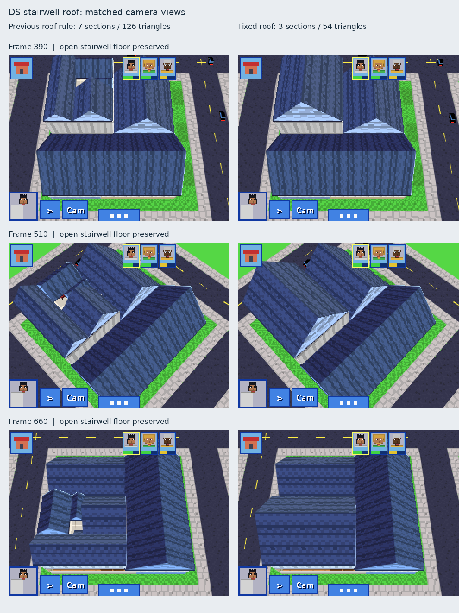

# All-port skating controls and DS rendering — 2026-11-21

This pass continues from main `f4f038630a86508a7263f5a981856933fbcec07f`.
It fixes two skating defects in the shared PS1/Dreamcast engine and its DS
implementation, repairs an upstairs DS roof, and makes DS scene budgeting use
the actual cost of cached character geometry. Save layouts and world generation
versions are unchanged. The implemented ports are PS1, DS/DSi and Dreamcast;
3DS remains a separate future port.

## Controls that now behave consistently

In [src/skate.c](../src/skate.c) and
[ds_games.c](../ports/dsi/source/ds_games.c), the wrapped steering difference is
in `-2048..2047`. The old reverse-stick brake required an absolute difference
of at least `2300`, so a player could never activate it. The brake now begins
at `1500`, where carving stops. Releasing the stick still coasts; pushing and
ordinary steering retain their existing behavior.

North/south rail attachment also used the opposite sign from subsequent grind
movement. Attaching could reverse the board's direction, including its ollie
exit. Attachment now uses the same map-y convention as the grind state.

The production-engine host test runs the PS1 and `BORE_DC` configurations and
checks braking, pushing, steering, rail attachment, travel and ollie exit in
all four cardinal directions. The native DS test exercises its real ARM9
controller with the same cases: **12/12 passed**, with coasting speed **22**
and reverse-stick speed **0** after 32 controller steps. The old implementation
fails the braking and north/south attachment assertions.

## Continuous roofs over open stairwells

The Man Base's upstairs bedroom deliberately has an open floor tile at its
stairs. The DS roof renderer previously treated that opening as a lower
storey, splitting the roof into small sections and putting a lower roof into
the stairwell.

[ds_roof_height_map](../ports/dsi/source/ds_render_geom.h) combines upper floors
with actual wall enclosure. A bounded exterior flood runs only while rebuilding
the static roof list. Doors enclose a room; fences and missing walls allow the
outside flood through. Lower wings and open courtyards keep their existing
height. The renderer reuses its 169-byte rectangle scratch grid; the helper
uses at most 338 bytes of temporary array storage and adds no permanent buffer.

The native A/B replay uses the actual Man Base, leaves the stairwell floor open,
and rotates the gameplay camera through three views. A test-only legacy switch
reproduces the original floor-only rule in the same codebase. The repaired roof
uses **3 sections / 54 counted triangles**, compared with **7 / 126** under the
old rule. All 12 samples per variant measured 30 FPS. Whole-frame peaks were
3,600 for the current rule and 3,602 for the legacy rule. The captures at frames
390/510/660 have exactly matching lot and camera state; clock and traffic keep
running. The comparison enlarges each native 256×192 gameplay screen by 2×
using nearest-neighbor scaling.



## Accurate DS geometry accounting and scene budgets

The expanded skating replay exposed a separate cache problem. A character cache
miss counted the model while recording it and then added an estimate of 120;
a hit counted only 120. An independent decoder of native RAM packets found real
model costs of **226–478 counted triangles**. The board's boxes were also counted
once by the box renderer and again by a trailing estimate.

Each cached model now stores its actual emitted triangle cost and charges it
exactly once at submission. Two 16-bit metadata fields replace one 32-bit
length field, preserving the **307,488-byte** cache allocation. The native FIFO
decoder checked **68 cached entries across three snapshots**, with no mismatch
and a maximum model length of **1,846 / 3,200 words**.

Correct counting alone revealed that scene caches could reuse too much scenery
after the dynamic cost changed. Item and world caches now include their budget
bucket in the signature and build against the bucket's upper bound. An unsafe
cached allowance triggers an immediate rebuild even when another static list
was rebuilt that frame. Optional street lamps and bins observe the remaining
detail budget, with the playable lot's kerbs drawn first. Roads, pavements and
ground retain their normal rendering.

The normal DS skating replay now checks geometry from the first active-board
sample, including cache startup. It passed **25 geometry samples**, peaking at
**3,618 counted triangles** against the existing **4,096** test limit. Its
17 steady riding samples measured **30 FPS min/mean/max**, with a geometry peak
of **3,608**. These are emulator measurements. Counted triangles are the game's
budget metric, not a direct certification of every DS hardware geometry limit.
Older reports based on the 120-triangle character estimate should not be used
as exact whole-scene geometry comparisons.

The new cache rules prevent reuse of an outdated discretionary-geometry
allowance. They do not impose a universal hard cap on arbitrarily large edited
buildings: primary building/dynamic geometry is preserved, and existing object
draw routines can admit a whole object after checking its starting count.

## Verification and preserved evidence

| Area | Verification | Result / scope |
|---|---|---|
| Shared PS1/DC controls | Actual `skate.c` in both host configurations | Four-direction braking, pushing, turning, rail travel and ollie exit passed |
| Native DS controls | melonDS ARM9 test ROM | All 12 cases passed |
| Native DS model cache | Independent FIFO vertex decoder, RAM frames 450/660/900 | 68 entries, zero mismatches, unchanged cache size |
| Native DS skatepark | 940-frame input replay and three native captures | 25 geometry samples, peak 3,618; steady 30 FPS |
| Native DS stairs/roof | Matching camera captures at 390/510/660 | Continuous roof; 54 versus 126 roof triangles; 30 FPS |
| Native DS house atlas | Three generated homes, Cutaway versus Always | Furnished interiors and complete roofs inspected in all three pairs |
| Native PS1 skating | DuckStation/OpenBIOS, ordinary 2 MiB RAM, 6,000 frames | All six scripted runs reached; score 350, five vert airs, one bail |
| Native Dreamcast skating | Flycast HLE, 16 MiB RAM, 4,000 frames | All six scripted runs reached; score 570, five vert airs, 70 grind steps, one bail |
| PS1 release | Native SDK, ELF and BIN/CUE | Built; text 28 bytes smaller than baseline, data/BSS unchanged |
| Dreamcast release | KOS native disc build | ELF, GDI and tracks built |

The PS1 script recorded no grind steps; the separate deterministic controller
test proves the four rail directions. The native route captures are gameplay
smoke evidence, not matched frame-time benchmarks. The PS1 image ends at
`0x801f8e14`; the remaining 29,164 bytes below the 2 MiB ceiling include runtime
stack needs and are **not** a measured free-heap figure.

Machine-readable reports and the roof comparison are kept in
[evidence/all-ports-2026-11-21](evidence/all-ports-2026-11-21/). The DS workflow
uploads fresh screenshots, logs and results for the controls, character cache,
roof replay and existing skate/house atlas. Its required gameplay gates also
cover purchase/save/load, safe deletion, 16 island/stair interactions, 218
fixture interactions across eight furnished homes, and the 162-home structural
audit. The shared build keeps world coherence and projection checks.

### Reproduce the focused regressions

With the repository's saved DS toolchain restored and `clang`, `ld.lld`,
`llvm-objcopy` and `llvm-nm` available:

```sh
bash test/skate_controls_regression.sh
bash test/projection_regression.sh
cc -std=c99 -Wall -Wextra -Werror ports/dsi/test/ds_render_geom_test.c -o /tmp/ds_render_geom_test
/tmp/ds_render_geom_test
DSRUN=/tmp/dsrun bash ports/dsi/test/ds_skate_controls_smoke.sh /tmp/ds-controls
DSRUN=/tmp/dsrun bash ports/dsi/test/ds_sim_cache_smoke.sh /tmp/ds-cache
DSRUN=/tmp/dsrun bash ports/dsi/test/ds_skate_smoke.sh /tmp/ds-skate
DSRUN=/tmp/dsrun bash ports/dsi/test/ds_roof_stair_smoke.sh /tmp/ds-roof
DSRUN=/tmp/dsrun bash ports/dsi/test/ds_visual_atlas.sh /tmp/ds-atlas
```

The cache script relinks `tools/dsemu/run.cpp` if the archived emulator lacks
RAM dumps. The saved melonDS libraries use GCC 13 LTO, so a local host with a
different default compiler must set `CXX` to a compatible compiler. CI uses
Ubuntu 24.04's GCC 13. The other replays work with the archived runner.

### Reproduce the native PS1/Dreamcast skating runs

Use fresh output directories and the restored native SDKs and emulator runners.
`AUTO_STORY=4` selects Skate Life; `AUTO_SKATE=1` enables the six-route hook
inside it. Do not add `AUTO_CITY`, whose independent walking input interferes
with the route. `$PS1_SDK` and `$PS1_REGTEST` below point at the restored SDK and
DuckStation regtest binary; the latter needs its restored OpenBIOS directory.

```sh
BORE_SRC=$PWD
BORE_PS1_BUILD=/tmp/bore-ps1-skate
BORE_PS1_EVIDENCE=/tmp/bore-ps1-evidence
cmake -S "$BORE_SRC" -B "$BORE_PS1_BUILD" -G Ninja \
  -DCMAKE_BUILD_TYPE=Release \
  -DCMAKE_TOOLCHAIN_FILE="$PS1_SDK/lib/libpsn00b/cmake/sdk.cmake" \
  -DPSN00BSDK_TC="$PS1_SDK" \
  '-DCMAKE_C_FLAGS=-DAUTO_STORY=4 -DAUTO_SKATE=1'
cmake --build "$BORE_PS1_BUILD" --target iso -j 4
mkdir -p "$BORE_PS1_EVIDENCE/shots"
for frame in 3600 3900 4200 4500 4800 5100 5400 5700; do
  echo "$frame shot"
done > "$BORE_PS1_EVIDENCE/route.txt"
mipsel-none-elf-nm --defined-only --print-size "$BORE_PS1_BUILD/bore2.elf" > "$BORE_PS1_EVIDENCE/symbols.txt"
(
  cd "$BORE_PS1_BUILD"
  env -u DS8MB DSCROP=None DSRAW=1 \
    DSSCRIPT="$BORE_PS1_EVIDENCE/route.txt" DSRAM="$BORE_PS1_EVIDENCE/ram.bin" \
    "$PS1_REGTEST" -log info -frames 6000 \
    -dumpdir "$BORE_PS1_EVIDENCE/shots" -dumpinterval 100000 \
    "$BORE_PS1_BUILD/bore2.cue" > "$BORE_PS1_EVIDENCE/run.log" 2>&1
)

source /tmp/dc/environ.sh
BORE_DC_BUILD=/tmp/bore-dc-skate
BORE_DC_EVIDENCE=/tmp/bore-dc-evidence
make -C "$BORE_SRC/ports/dreamcast" O="$BORE_DC_BUILD" \
  AUTO='AUTO_STORY=4 -DAUTO_SKATE=1' -j 4 disc
mkdir -p "$BORE_DC_EVIDENCE"
for frame in 600 900 1200 1500 1800 2100 2400 2700 3000 3300; do
  echo "$frame shot"
done > "$BORE_DC_EVIDENCE/route.txt"
sh-elf-nm --defined-only --print-size "$BORE_DC_BUILD/bore2_dc.elf" > "$BORE_DC_EVIDENCE/symbols.txt"
(
  cd "$BORE_DC_BUILD"
  DCRUN_SYS="$BORE_DC_EVIDENCE/system" DCRUN_RAM=1 \
    /tmp/dc/pack/bin/dcrun /tmp/dc/pack/bin/flycast_libretro.so \
    "$BORE_DC_BUILD/bore2_dc.gdi" 4000 "$BORE_DC_EVIDENCE/skate" \
    "$BORE_DC_EVIDENCE/route.txt" > "$BORE_DC_EVIDENCE/run.log" 2>&1
)
```

Expected: eight PS1 captures and a 2,097,152-byte RAM dump; eleven Dreamcast
captures (including final frame 3999) and a 16,777,216-byte RAM dump. Using the
matching ELF symbols, confirm `state=3`, `world_zone=3`, `story_id=4`,
`on_board=1`, `has_board=1`, `wsalt=0x5EED1234`, and route-start events
100 through 105. Dreamcast symbols have leading underscores and map into
the dumped RAM with `address & 0x00ffffff`. PS1 capture names include a startup
offset; validate their contents rather than relying on exact filenames.

## Remaining work

OW-004 and QA-004/005/008/009 remain partial. This pass does not certify every
building or camera angle. Still needed: matched-location map/near/far and
interior captures across all ports, broader rail/coping routes, console
frame-time measurements, physical save media, and a separate enhanced-DSi
validation pass. The baseline Dreamcast in-session VMU round trip and PS1 lens
replay were also checked during setup; they are not new cold-boot or physical
hardware results for this change.
