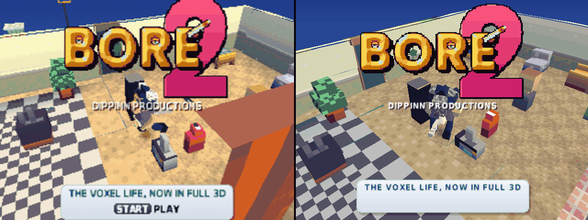
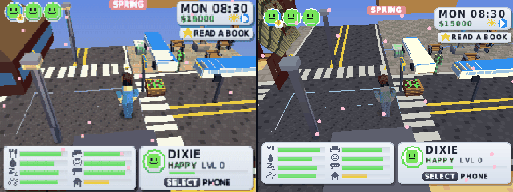

# Dreamcast port: where it stands

Status: **the real PS1 game code runs** (main.c, world.c, voxel.c, the UI...) on a Dreamcast platform layer; the PS1 title shows in flycast. The PS1 build is unchanged: `src/` edits are only under `#ifdef BORE_DC`, checked with `ports/dreamcast/ps1_check.sh` (the same Release image before and after). Build and emulator steps: `ports/dreamcast/README.md`.

## How it works now (the real game)
The Dreamcast build compiles the PS1 game's own sources (the CMakeLists file list, overlays linked in) and swaps only the platform:
- `ports/dreamcast/psx/`: PSn00bSDK's headers (psxgpu, psxgte, pad, cd, spu), a minimal psxapi.h, `hwregs_c.h` pointed at a plain array, and `inline_c.h` = the GTE in C with the PS1's fixed-point rules.
- `dc_psx.c`: the GTE library (RotMatrix, CompMatrixLV, ApplyMatrixLV, isin/icos...). `dc_gpu.c`: the PS1 GPU: VRAM kept in RAM, DrawOTag walks the ordering table and sends every primitive to the PowerVR in the same order (a depth step per primitive), 4/8/15-bit texture pages converted to PVR textures, the 4 blend modes, sprite cells rasterised into VRAM. `dc_plat.c`: the maple pad as a PS1 pad, overlays linked in, RAM as the 8 MB PS1, sound and memory card silent for now.
- `src/` edits, all `#ifdef BORE_DC` (atlas.c VRAM upload, gfx.c/gfx.h profiler clock, world.c scratchpad, main.c stack paint). `ports/dreamcast/ps1_check.sh` builds the PS1 Release elf: `_end` 0x801fc2e4 and the image sha1 464525f8... are the same before and after.

## What works (flycast, HLE BIOS, 640x480) - side by side with the PS1 (DuckStation, 8 MB)
Left: the PS1 build in DuckStation. Right: the same code on the Dreamcast (flycast).

Title (the camera turns with time, and the Bore is rolled at random, so the two are a few seconds apart):

SAN BOREAS, the same moment in both: a test build (`AUTO_CITY=1 AB_LOCK4=1 AB_FREEZE=150`, the PS1's own test hooks) starts a life
in the city with the same seed and freezes it after 150 life frames, so both show MON 08:30 at the same crossing:

What still differs: the PS1 dithers (the Dreamcast draws 16/32-bit without it), the bus shelters' roofs lose their blue tops
(a semi-transparent texture rule still to match), hair colours are a little darker. No sound yet; no memory card yet.

How the city shot was taken: PS1 `cmake ... -DCMAKE_C_FLAGS="-DAUTO_CITY=1 -DAB_LOCK4=1 -DAB_FREEZE=150"`, `ninja iso_lite`,
`DS8MB=1 test/ds.sh bore2_lite.cue NAME 3500 script` (shot at 3400). Dreamcast `make AUTO="AUTO_CITY=1 -DAB_LOCK4=1 -DAB_FREEZE=150"`,
`dcrun flycast_libretro.so bore2_dc.elf 1000 PREFIX` (shot at the end).

Bugs found on the way (fixed): a shadowed variable in the GTE's three-vertex load (people exploded into huge polygons),
the PS1 GPU's rule that skips triangles wider than 1023 or taller than 511 pixels, the sprite cells' set-mask bit, and
ApplyMatrixLV / CompMatrixLV now pass vectors through the GTE's 16-bit IR registers as the SDK does.

Pad mapping: A = CROSS, B = CIRCLE, X = SQUARE, Y = TRIANGLE, triggers = L1/R1 (both = L2+R2), START+both triggers = SELECT.

## Next
SAN BOREAS street; DuckStation-matching PS1 shots side by side; then sound (AICA), VMU saves, and the Dreamcast upgrades and extras.

## Carry-over plan (unchanged)
| PS1 layer | Dreamcast replacement |
|---|---|
| `gfx.c` GTE camera, ordering table | `dc_gfx.c`: PVR polygons with the depth buffer (done for flat/gouraud; textures next) |
| `voxel.c` joints | same maths on the SH-4 FPU |
| `audio.c` | AICA through `snd_stream` |
| `pad.c` | maple `CONT_*` (done in `dc_pad`) |
| `mcard.c`, `save.c` | VMU via `vmu_pkg` |
| Overlays | not needed: 16 MB RAM |

Rule for the PS1: Dreamcast work stays under `ports/dreamcast/` and `tools/dcrun.c`; any edit of `src/` would be `#ifdef BORE_DC` only, and a plain PS1 Release build must keep the same `_end`.
