# Dreamcast port: where it stands

The real PS1 game code (`src/`) runs on the Dreamcast. Only the platform layer is new (`ports/dreamcast/`).
`src/` edits are only under `#ifdef BORE_DC`; `ports/dreamcast/ps1_check.sh` shows the PS1 Release image is unchanged
(last check: `_end` 0x801fd6d4, image sha1 9e71d5420789ccf6, the same with and without the Dreamcast edits).
Build, disc and emulator steps: `ports/dreamcast/README.md`.

## What works now
| Part | How |
|---|---|
| Game, menus, rules | the PS1 sources, unchanged, overlays linked in |
| Picture | PS1 GPU ordering tables turned into PowerVR vertices (`dc_gpu.c`), 640x480, **24-bit colour** (no dithering, no banding) |
| Semi-transparency | only texels with the STP bit blend, the rest is solid, as on the PS1 (bus shelters now right) |
| Brightness | PS1 textures can be lit up to 2x; the PowerVR stops at 1x, so a second added pass makes up the rest (roads, people now as bright as the PS1) |
| Sound | the PS1 sound code (`audio.c`) unchanged, on a software SPU (`dc_spu.c`: ADPCM, gaussian interpolation, ADSR, reverb) mixed to the AICA at 44.1 kHz. Music, voices and the volume sliders work |
| Disc | `make disc` builds `bore2_dc.gdi` (boots in flycast). Songs and voices are read from the disc (`dc_cd.c`) |
| Saves | on the VMU (`dc_vmu.c`). Save, load, options and story come back (tested). Icon has 3 frames (look, blink, grin) |
| VMU screen | your Bore's face (follows the mood), name, clock and 4 needs |
| Options > EXTRAS | a Dreamcast-only tab: COLOURS (VIVID / CLASSIC PS1), TEXTURES (SHARP / SMOOTH), JUMP PACK, VMU SCREEN |

## Pictures
PS1 in DuckStation (left) and the Dreamcast (right), same city moment, after the brightness and blend fixes:
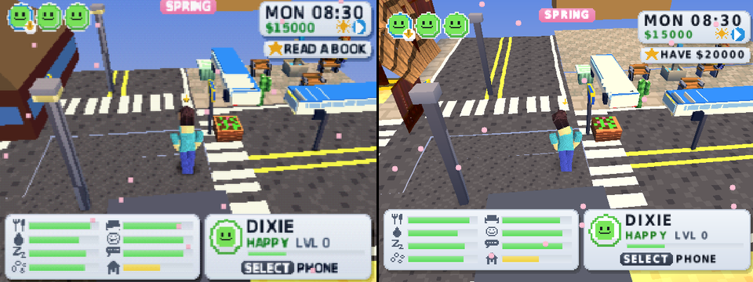

Colours: CLASSIC PS1 (left) and VIVID (right, the default). Vivid = 1.45x saturation, 1.05x brightness, on shading and textures:
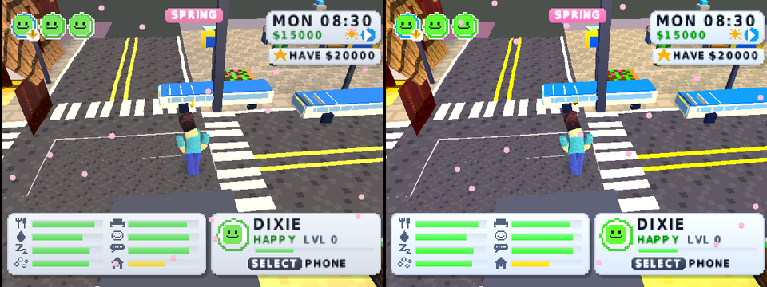

Textures: SHARP (left) and SMOOTH (right, bilinear on the 3D world only; menus stay crisp):
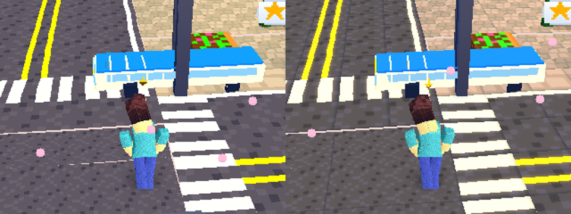

The EXTRAS tab, the VMU save icon (3 frames) and the VMU screen:
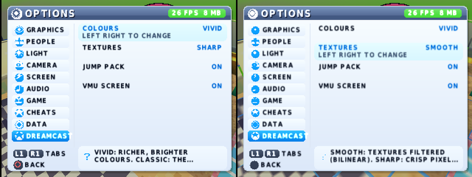
 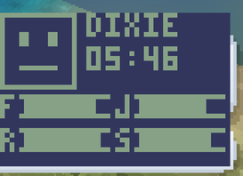

Older shots: `dc_vs_ps1_title.png`, `dc_vs_ps1_city.png`.

### Roofs: the roof-tool bug (fixed)
The ROOF tool pulls the camera out so the whole roof shows. On the Dreamcast the roof showed for a moment, then vanished.
Cause: the roofs are drawn last, and the PS1 packet buffer (58 KB, of which the world may use about 20 KB) ran out of room
(130-220 primitives dropped a frame) at full detail range. The PS1 build looked fine only because its speed helper had shrunk the
detail range. Fix: on the Dreamcast (`#ifdef BORE_DC` in `src/gfx.h`) the packet buffer is 160 KB and the PowerVR vertex lists are
bigger. Left: PS1 (DuckStation). Right: Dreamcast, same moment of the `AUTO_HOME` test (buy a house, build, the roof tool).
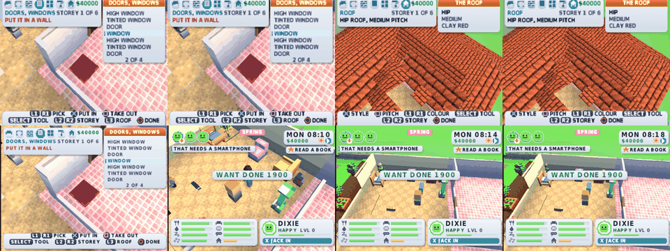
How: PS1 `cmake -DCMAKE_C_FLAGS="-DAUTO_HOME=1 -DAB_LOCK4=1"`, `ninja iso_lite`, DuckStation with START at 1100 and X at 1180, shot near 3200;
Dreamcast `make AUTO="AUTO_HOME=1 -DAB_LOCK4=1 -DDC_NOSPEED -DDC_CLASSIC" disc`, script `ports/dreamcast/test/home_dc.txt`.
Note: a Dreamcast test frame is about 2 vblanks, a DuckStation frame 1, so pair shots by the clock on the HUD.

### Roofs: better Dreamcast roofs (BORE_DC only)
A 32x32 clay-tile texture (rounded tiles, offset courses; filtered when TEXTURES is SMOOTH), a ridge board along every roof top,
and rooftop boxes on flat roofs. Chimneys and the PS1's eaves stay. The cut-away is unchanged: the roof of the building you are in is
left out (left: roofs from the street; right: the Sim inside a shop, its roof hidden). Not done yet: a fade for the cut-away.
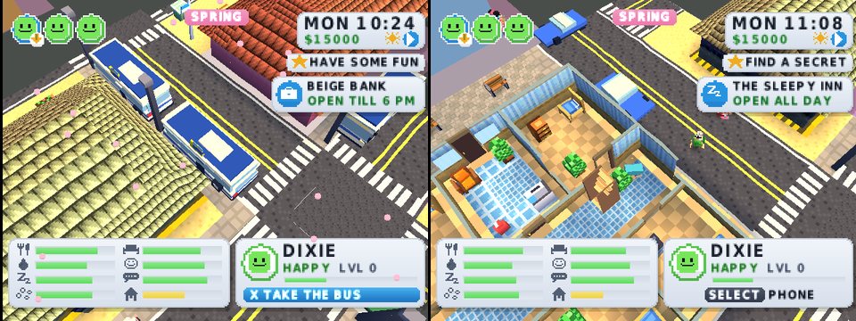
The city roofs could not be paired with DuckStation: in the PS1 test run the Sim walked off to a field, so the two routes differ.

## Speed (measured in flycast, which only roughly copies real Dreamcast timing)
SAN BOREAS street, normal play (`AUTO_CITY` build, 1500-2500 frames in):
| Step | fps |
|---|---|
| start of this round | 22-28 |
| faster sound mixer, no 64-bit divides | 26-29 |
| a late frame no longer waits for the next vblank | 41-48 |
| vertices written straight into PowerVR lists | 39-49 (CPU 230-360 of 262 hblanks a frame) |
| sound mixed at 22.05 kHz then interpolated up, reverb registers read once per stretch, FPU divide in the GTE, colour-grade cache | see below |
Round 2 (same flycast, same `AUTO_CITY` build without `AB_LOCK4`; the Sim walks a different way each run, so only roughly comparable):
| Step | fps | CPU hblanks of 262 |
|---|---|---|
| before round 2 | 29.5-30.5 | 515-540 |
| after round 2 | 36-36.5 | 433-437 |
Profile after round 2: GTE RTPS 16%, ordering-table walk + vertex writing (`emit`, `emit_one`, `DrawOTag`) 31%, reverb 8%, texture cell conversion 4.5%, mixer 3-5%.
So: still not a steady 60 (the CPU needs under 262 hblanks a frame; it is at about 435 in this street). Where the time goes (profiler, `make PROF=600`): sound mixing 17%, GTE 11%,
ordering-table walk 15%, the rest is the game itself.

## How shots and numbers are taken
`make O=obj_x AUTO="AUTO_CITY=1 -DAB_LOCK4=1 -DAB_FREEZE=150 -DDC_NOSPEED" disc` then
`dcrun flycast_libretro.so obj_x/bore2_dc.gdi 1000 NAME [script]`. `DC_CLASSIC`, `DC_SMOOTH` pick the Extras for a test.
`DCRUN_VMU=1` draws the VMU screen into the picture. The log (fps, CPU, lists) prints at the end.
PS1 side: `DS8MB=1 test/ds.sh bore2_lite.cue NAME 3500 script`.

## REAL TIME (OPTIONS > GAME)
The Dreamcast reads its own clock chip (`dc_rtc_min` in `dc_plat.c`, KOS `rtc_unix_secs`, read twice a second at most): switching
REAL TIME on asks nothing (the PlayStation has no clock and asks the time). The clock, weekday and season (by the month) follow the
Dreamcast's clock; flycast gives it the host's time. Left: the option on, no question; right: SAN BOREAS at the real 18:38.
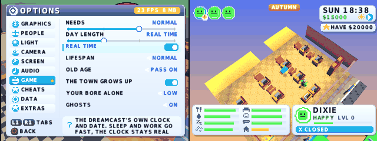

## Button names (A/B/X/Y)
On screen the PS1 words become the Dreamcast pad's, in `src/font.c` under `#ifdef BORE_DC`: X = A, O = B, SQ / SQUARE = X, TRI / TRIANGLE = Y
(whole words only; the PS1 build is untouched). Shot: the talk bar says "A TALK".
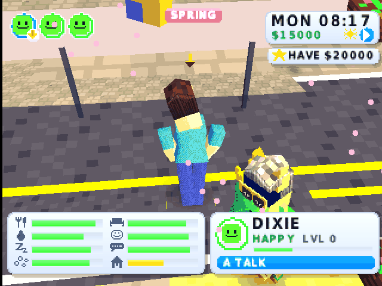

## Round 3 (speed, pads, VMU pet)
Speed (flycast, same `AUTO_CITY` street; the Sim walks a different way each run, so this is rough: CPU hblanks a frame, 262 = 60 fps):
| Step | CPU hblanks | fps seen |
|---|---|---|
| start of round 3 | 470-540 | 29-46 |
| 32-bit GTE RTPS (no 64-bit shifts), incremental integer sprite rasteriser, 4-bit texture cells by palette, texture check skipped while VRAM is unchanged, packet prefetch | 420-500 (260-300 in quiet streets) | 31-52 |
Profile now: GTE 10%, emit/emit_one/DrawOTag 23%, reverb 8%, cell conversion 5%, idle 8%. Still no steady 60 in the busy street. The profile showed the
people-sprite rasteriser (software, into VRAM) was a big part of `emit`; it is about 3x cheaper per pixel now.
- 2 players in the fight game: a controller in port B plays the second fighter (`dc_pad2` in `dc_plat.c`, `#ifdef BORE_DC` in `src/fight.c`; with no
  second pad the AI plays as before). Not tested with a real second pad (the test emulator has one pad). Mini-games and Family Party still read pad A only.
- VMU: when the Bore you play owns a Boreagotchi toy, the VMU screen shows the pet for 2 of every 6 seconds (blob by stage, an egg before hatching, hearts for
  food and fun, a mess mark, "CALLS YOU!", XP). Shot: `dc_vmu_pet.png` (test build `-DDC_FAKEPET`). Rewards do not carry back to the game yet.
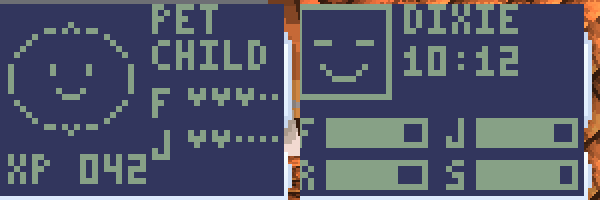
- PS1 check: `ports/dreamcast/ps1_check.sh` gives the same image with and without the Dreamcast edits (`_end` 0x801fc044, sha1 9cfdf4cec1aaaad0 on this tree).
- Shadows: the game already draws a soft shadow under every person (`gfx_shadow`, subtract blend); no change needed.

## Round 4 (Nov 8): speed, furniture, outfits, gallery, night glow
### Speed: honest table
Method: the frozen street (`AUTO_CITY=1 -DAB_LOCK4=1 -DAB_FREEZE=150 -DDC_NOSPEED`), the same city frame every run, so only the code differs.
CPU hblanks a frame (262 = 60 fps; this is the game's whole frame up to the flip, drawing included):
| Step | CPU hblanks | vs start | opaque vertices |
|---|---|---|---|
| start of round 4 | 326 | | 1645 |
| primitives wholly off screen or with no area dropped before the PowerVR (`dc_gpu.c`, `emit`) | 320 | -2% | 1247 |
| 32-bit projection in the GTE when the products fit (`dc_psx.c`) | 313 | -4% | |
| reverb with ring offsets worked out once per stretch, bit-exact (`dc_spu.c`; checked against the old code on 2.4 million random steps) | 309 | -5% | |
That is about 48 fps before and 51 fps after if nothing else stalls (60 x 262 / hblanks). Free-running streets are not comparable run to run (the Sim takes another
route): 46 fps average over 13 readings before, 48 after, with different scenes. Still NOT a steady 60.
Profile now (busy time only): sound 26% (reverb 17%, mixer 9%), emit/emit_one/DrawOTag 21%, GTE 10%, the game itself the rest.
Not done: sound on the AICA's own channels (a different ADPCM and reverb: a large job and the sound would change), SH-4 FIPR/FTRV for the GTE (the GTE
is only 10% and the PS1 matrices are 16-bit fixed point: float would not be bit-exact), a direct PVR path for the world and the people.
Tried and not kept: reverb at half rate again (saves about 3.5% but darkens the reverb; not judged by ear, so left out).

### Dreamcast furniture set (BORE_DC only, `src/items_dc.inc`)
Six new items, letters 0xF7..0xFC, bought in build mode (FUN AND TECH: DREAMCAST, VMU ON A STAND, DC ARCADE CABINET; DECOR: SWIRL RUG, ORANGE and BLUE SWIRL LAMP).
Left: the six in a row (test build `-DDC_SHOWITEMS=1`), right: the other order (`=2`). They now stand on a shop floor, the nearest free plot floor to the Sim (the first picture of this set had them in the street at a crossing: the hook put them on the row below the Sim, wherever that was; see "Streets" below). The lamp shades sit on a collar and narrow to the top.
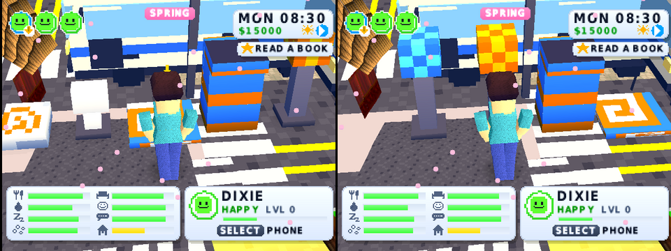
They are plain decor (the cabinet does not start a game). The PS1 build has none of them (`ITEMS_DC` is empty there).

### Dreamcast outfits and the gallery
Four outfits are appended to the OUTFIT list (WEAR tab) under BORE_DC: ORANGE SWIRL, BLUE SWIRL, ARCADE KID, JUMP PACK HERO (built from the PS1's own wear items;
the PS1 outfit numbers do not move). OPTIONS > EXTRAS > DREAMCAST GALLERY lists the six items and four outfits: FOUND once you have built the item in a home or worn the outfit
(kept for the session only: it is not saved; the real unlock list needs a place in the save). Shot: the gallery (items you placed are found; here the Sim had walked away, so only the lamp shows).
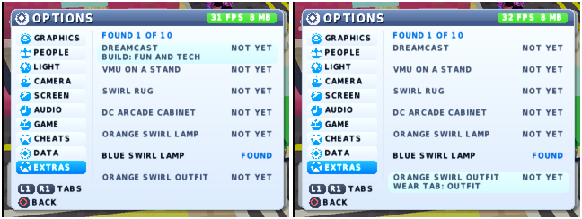

### Night glow
After dusk (the light's ambient below 72) every street lamp head and the two Dreamcast lamps get a warm (blue for the blue lamp) additive halo: a 16x16
gradient in the atlas drawn as a blended sprite, fading in with the dusk (`items.c`, BORE_DC). Test build: `-DDC_NIGHT=22` fixes the clock at 22:00.
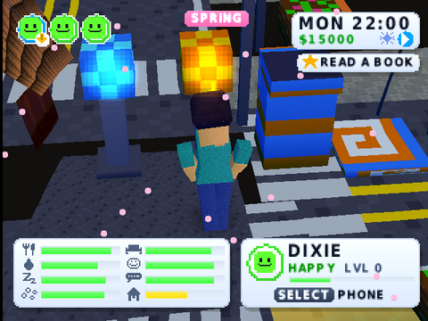
The halo is a 2D sprite over the picture (no depth test), so a lamp behind a wall can show its glow; people in front of a lamp are covered by it.

### Controllers B, C, D
`pad_read(port, ...)` now answers for ports 0..3 (it was port 0 only), so the arcade's two-player games, which read port 1, take a second player on controller B
(plus the fight game as before). Nothing else in the game reads pads C and D. Not tested with a real second pad (the test emulator has one).

### Checks
`ports/dreamcast/ps1_check.sh` on the tree before this round's last two commits (cd53150) and on the tree after them: `_end` 0x801fc544, image sha1 2b03311fea2830e6, the same. (Also the same on f93a938 against the first two commits: `_end` 0x801fc234, sha1 ae63c2837a8fd5e2.)

## Still to do
- Side by side with DuckStation (pie menu, night, first person, far view, a park, roofs): NOT done this round. The frozen AUTO_CITY test builds do not take input, and the
  PS1 test build sits a different distance from the street than the Dreamcast one (the PS1 side needs the helper switched off through the disc's test patch); the pairs
  need scripts that both sides follow. The older pair above (`dc_vs_ps1_city2.png`) is the last good one.
- Boreagotchi rewards back from the VMU: not done. It needs a program on the VMU itself (the VMU only shows what the console draws), which the toolchain here cannot build.
- Translucent water: not done (glass already blends on both PS1 and Dreamcast: it is a semi-transparent quad in `world.c`). Water is an opaque scrolling floor tile.
- Pads C and D: only readable (`pad_read(2/3)`); no game uses them. 16:9: not done (the HUD, camera and culling are for 320x240). Sub-pixel vertices: not done
  (every packet is whole pixels: it needs `src/` changes where packets are built). A real depth buffer and PVR fog by depth: not done; the game already fades colours with
  depth (`gfx_set_fog`), so PVR fog would double it. Bigger crowds and detail radius: the OPTIONS already go to 64 people and radius 14; a bigger default costs speed.
  Smooth lighting: not done.
- The unlock list is not saved (see above). Roofs: a fade cut-away; far roofs with fog. The far buildings' window textures use the PS1 texture window (GP0 E2): not done in `dc_gpu.c`.
- Steady 60 fps: see the speed table.

## What the Dreamcast needs next (updated Nov 8)
See also ROADMAP.md and EXPANSION_PACKS.md. The disc in the repo history is a few hours behind main: rebuild with the `build-dreamcast` workflow or `make disc`. In order:
1. Speed toward 60 fps: sound on the AICA, a direct PVR path for the world and people.
2. Side-by-side checks against DuckStation with scripts both sides follow.
3. Save the unlock list; Boreagotchi rewards (needs a VMU program); translucent water.
4. Upgrades: sub-pixel vertices, 16:9, smooth lighting.
5. Disc packs: put the PS1 packs on the disc as files (see EXPANSION_PACKS.md).
6. Real hardware test.

## Hair (Nov 2026)
The PS1's new mesh hair (26 styles, `src/hairmesh.inc`) draws correctly under the Dreamcast GPU layer with VIVID on: Create-a-Sim and the street (docs/hair_dc_styles.png, docs/hair_dc_street.png; PS1: hair_ps1_styles.png, and hair_ps1_before_after.png: close, zoomed out, first person, old on top of new for each pair; first person shows no hair because your own head is not drawn). The Makefile was behind the PS1 source list and did not link; the missing files and overlays are in now (see PS1_PERFORMANCE.md, "Hair").

## Nov 8 check (hair and discs)
Disc rebuilt from main (`make disc`, 7.2 MB track 3). In flycast: title, city HUD and the Create-a-Sim hair tab work, new hair styles, beards and all dye colours draw (`docs/hair_dc_dye.png`; test build `AUTO="HAIR_AUTO=24 -DHAIR_DEV=400"`, tab keys on Dreamcast are `r2`). Not checked: packs shelf, arcade lot.

## Streets: nothing on a road (Nov 8)
The picture the user sent twice (a swirl rug, a console, lamps and the cabinet standing on a crossing, `dc_furniture.png` as it was) was this port's own test hook, not the generator: `-DDC_SHOWITEMS` set the six furniture items down on the row south of the Sim, and the test Sim stands on a crossing. Fixed in `dc_extra.c`: it takes `world_tile_class` (`src/world.c`, the one definition of road / kerb / plot every port now uses), looks in the window's two middle blocks for the nearest run of free plot floor (lawn, plaza, patio first, then any floor, never a road, never the pavement), puts the items there and holds the Sim behind them. New picture: `docs/dc_furniture.png`. Same crossing before and after (and the PS1 and the DS): `docs/street_props_before_after.png` (top row: Dreamcast, old test hook on the left; the crossing is clear on the right).
- The road test: `ports/dreamcast/test/roadaudit.sh` (a test build `-DROAD_AUDIT=1`, headless in flycast, about a minute): every block of every town and city, every highway and a grid of open country (1955 windows, 31,296 blocks, 589,477 things) is checked against the definition; it fails if anything stands on a road tile or the painted streets and the map's road bits disagree. Before the fix: 1 thing on a road (a bench in a house's yard that slipped to the road's edge), 1 purged. After: 0 / 0 / 0, PASS, and 0 even with the clean-up off (`-DROAD_NOPURGE=1`). The PS1 build has no room for the sweep (AUTO_CITY alone leaves under 5 KB past `_end`), so the shared code is tested here.
- Lamps: `items_dc.inc` gives both swirl lamps a collar under the shade and a shade that narrows to the top (5 boxes, BORE_DC only).
- PS1 check: `src/world.c` changed (shared): `street_purge` replaces `street_clean`; `ps1_check.sh` before (upstream e9011fb) `_end` 0x801fd258, sha1 0d00a3c1fb1b7592; after `_end` 0x801fd3d0, sha1 39602b57db87cf48 (11,312 bytes free on 2 MB), so the PS1 image did change here, by 376 bytes of code. The DC-only files (`items_dc.inc`, `dc_extra.c`) do not reach the PS1.
- Disc: `bore2_dc_streets.zip` (gdi + 3 tracks, 5.6 MB).

## Lots that look designed (Nov 8)
The generators are shared (`src/lots.inc`), so the Dreamcast gets the new houses (rooms, doors, bath cells), parks (five designs) and shops (aisles, stands, tills) with no Dreamcast-only code. The only `BORE_DC` edit is the test tour's camera (`src/main.c`, AUTO_LOTS: the Dreamcast's lens is tighter, so the distance is doubled); `ports/dreamcast/ps1_check.sh` is unchanged. The picture sent twice (hazard-striped floor, furniture in a diagonal row) was the furniture test hook plus the old generator's factory floors; houses now draw floors from the calm list only. Shots: `docs/lots_dc_before_*.png`, `docs/lots_dc_after_*.png` (house inside, yard, shop, park, street overview). Road test result: see the end of this section.
Road test after the lots round (`roadaudit.sh`): 1955 windows, 31,296 blocks, 590,772 things, ON-ROAD 0, walls-on-road 0, roadfloor-off-strip 0, strip-not-road 0, PASS. PS1 Release `_end` leaves 20,112 bytes free on 2 MB (was 17,496 before the merge of other work; limit 10 KB). Disc images are test builds in `/tmp/dc/o_lots_after/bore2_dc.gdi` (AUTO_LOTS tour) and `/tmp/dc/o_roadaudit/`.

## World version 7 on the Dreamcast (Nov 13)
- **Toolchain restore, one command:** `ports/dreamcast/toolchain/restore.sh` (5 s for the tarball, then it rebuilds `dcrun` from `tools/dcrun.c` in about 2 s, which needs `gcc` and `curl`: `libretro.h` comes from libretro-common into `/tmp/dc/lrh`). The `dcrun` in the tarball is OLD: it does not print the game's log, so no fps, no road audit result. After it: `source /tmp/dc/environ.sh`, `cd ports/dreamcast && make O=/tmp/dc/o_x disc`. A test build with other `AUTO=` flags needs `rm /tmp/dc/o_x/main.o` first (the Makefile does not track the flags).
- **Disc:** `make disc` of main with world version 7 builds clean (no Dreamcast-only compile error), 1,744,064 byte `1ST_READ.BIN`, 7.4 MB track 3, `/tmp/dc/o_p7/bore2_dc.gdi`. The ordering table macros are already per platform in `src/gfx.h`: the Dreamcast keeps `OT_NEAR 4096`, `OT_SHIFT 1`; only the PS1 uses 2048 / 2. Memory: no out-of-memory or crash in the 6 minute walk and in the audit sweep of every town; the PowerVR vertex memory (`pvrfree` in the log) stayed at 1.7 MB free. The heap itself was not measured by a counter, only by not failing: the far-view footprints (`fb_ft`) were not looked at separately.
- **Road test, gen 7, four worlds** (`ports/dreamcast/test/roadaudit_seeds.sh`, `-DAUTO_SEED=0x..u`; 3000 frames each; every town, city, village, highway and a grid of open country): worlds 0x5EED1234, 1, 0xC0FFEE: ON-ROAD 0, walls-on-road 0, strip-not-road 0, generators left on a road 0 (so nothing stands on a street tile). One count is NOT zero: **roadfloor-off-strip 775 / 875 / 625** (31,296 to 35,920 blocks). The first offenders are all tile (0,0) of the block (the crossing's corner) on PARK and EMPTY lots: the corner tile is painted road where `world_tile_class` says it is not road. Cosmetic (one tile at a crossing), not a prop on a road, but the audit's old rule was 0 so `roadaudit.sh` says FAIL. It is in the generator (`src/world.c` / `bigmap.c`, owned by another helper): not fixed here.
- **Shots** (real flycast, world 0x5EED1234, `AUTO_CITY` with `-DAUTO_AT_BX=0 -DAUTO_AT_TAB=1 -DAUTO_AT_STEP=1200`, places in `ports/dreamcast/test/plan7_places.inc`): `docs/plan7_dc_suburb_south.png`, `plan7_dc_suburb_north.png`, `plan7_dc_estate.png`, `plan7_dc_centre.png`, `plan7_dc_corner.png`, `plan7_dc_village.png`, `plan7_dc_house_inside.png`, `plan7_dc_far.png`, `plan7_dc_town_centre.png`. Seen: houses stand back behind a yard with hedges, a path and a lamp from the door to the street; the north-facing house has its door and path on the street side; the house interior shows rooms with furniture in groups and a tiled bathroom cell. The Dreamcast camera is tight (the longest zoom shows about 12 tiles), so the spacing of several houses in a row is only partly in one picture. Not judged: a wide street of many houses, and the traits / life panel by a menu script (only the person's info box was seen in a shot).
- **Soak:** 11,200 flycast frames of the plain `AUTO_CITY` build (the Sim walks at speed east through the city, the game clock runs 8:00 to well into the evening), no crash, no freeze. 109 readings: CPU 218 to 636 hblanks a frame, average 350 (262 = 60 fps), so about 45 fps by CPU; the log's own fps average 41.6 (min 20 while two other emulators ran on the same two cores, max 56). The gen 6 baselines in this file are 31 to 52 fps: the same range.
- **Save round trip (v53 on the Dreamcast build): NOT done.** A v53 VMU save could not be made in this session (the old build's test hook did not leave a VMU file; `dcrun` ends with `_exit` before flycast writes it). The code path is shared with the PS1 (`bm_gen = save_ver >= 54 ? 7 : ...`), which the housing round tested in the PS1 emulator.
- Test hooks added (test builds only): `-DAUTO_SEED=0x..u` (another world for the audit), `-DAUTO_AT_TAB=1 -DAUTO_AT_STEP=n` (a list of places, the sim and camera follow the window every frame because the window moves a moment after the taxi; the camera may pull out to 7000).
