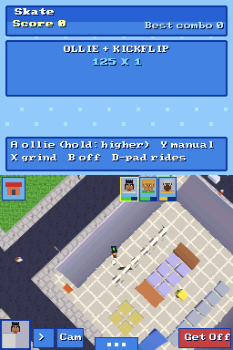
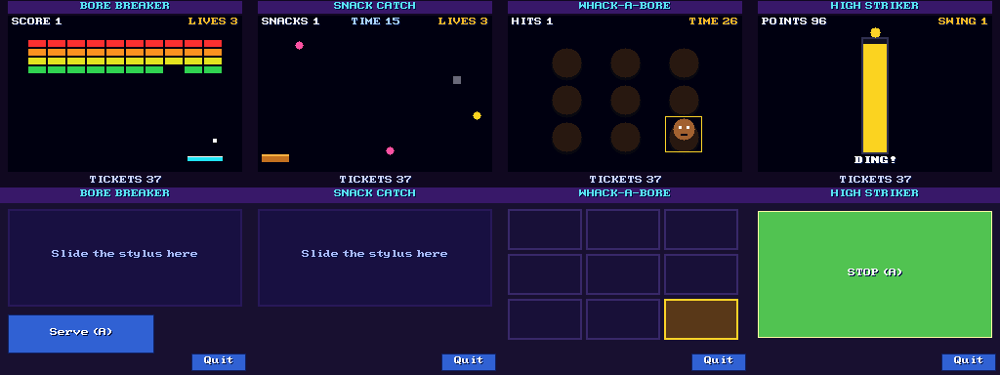
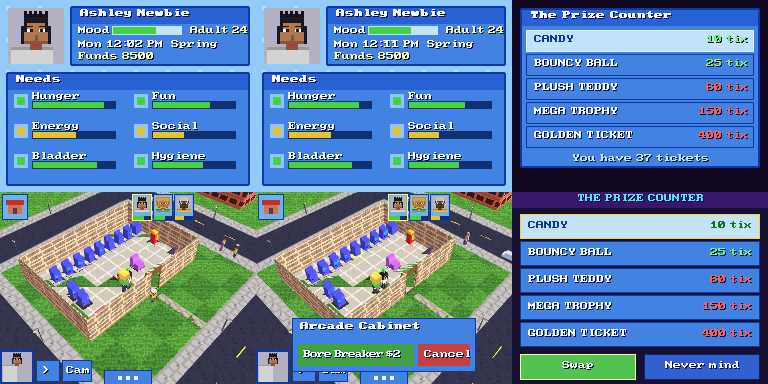
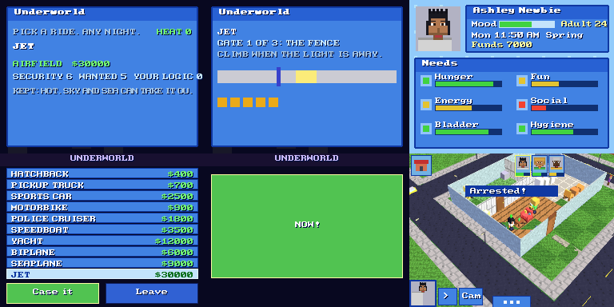
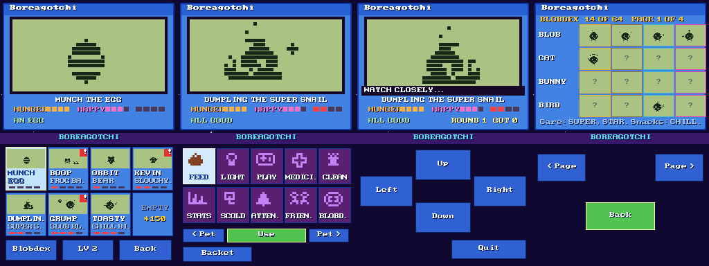
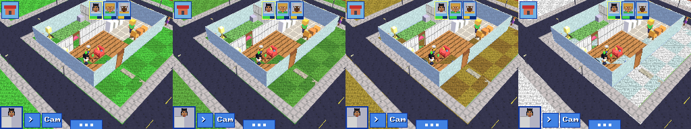
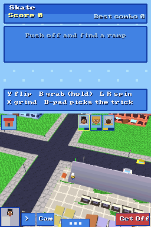
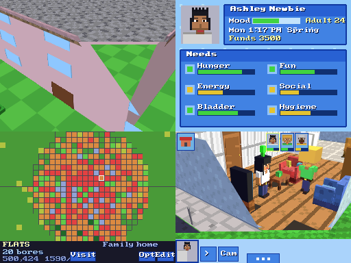
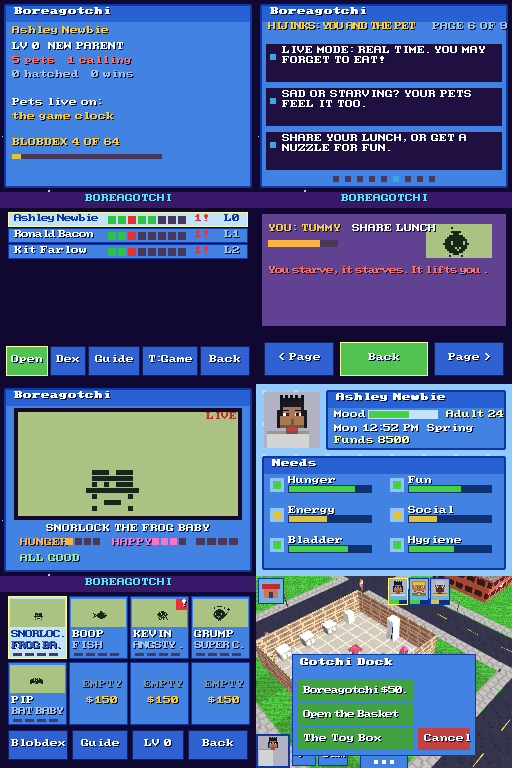

# BORE 2 DS / DSi: roadmap (updated at D43)

## Where we are
A Sims-DS style life sim on two screens, one ROM (`bore2_dsi_d43.nds`) that runs on DS, DSi and the emulators (melonDS, DraStic, NooDS, DeSmuME).
Tested in melonDS only. Not yet tested on real hardware or on Android emulators.

**Done**
- Title (new BORE 2 logo, Household Occupants, Start/Load), Create-a-Sim (12 hairs, beards, faces, 26 sliders, paint pad), Map with drag editor, LIVE, drag Buy and Build, 400 items per lot, yards, fences, life stages, families, citizens and cars, shops and parks, 2000-bore cap.
- Saving (D22-D24): 8 KB EEPROM, A/B copies with a checksum, 48 remembered lots, stats; "Save space: Safe/Max".
- Real ARM7 (touch, sound), tabbed Options (Graphics / Audio / Game / System), Options inside a lot, jagged-ground fix (D27).
- **Music (D29): the PS1 jukebox on the DS, no streaming.** All 52 songs. `tools/dsmusic/mk_dsmusic.py` reads `assets/SONGS.BIN`, decodes each instrument from the PS1 sound chip's ADPCM, re-encodes it as DS IMA-ADPCM, and flattens every song to a time-ordered note list with the voices already shared out (9 voices; the rest of the 16 channels are kept for the game's own sounds). `tools/dsbuild/addmusic.py` appends the result (`assets/dsmusic.bin`, 5.7 MB) to the .nds and patches its address into the game (`MUS_LOC`). At run time the game reads one song (about 300 KB at most) off the cartridge into RAM and plays each note on a sample channel, once a frame. No streaming, almost no CPU.
  - Audio tab: Music source (Songs / Synth), Song (Auto or 1-52). Auto: the title song (THE DIPPER MAN) on the title, then a random song in the game, the next when one ends. The Options title shows what is playing.
  - Safe fallback: if the cartridge cannot be read (a loader that only gives us the code), the old synth tunes play.
  - Known limits: no reverb or per-song effects (the DS has none), polyphony 9 (busy songs drop the oldest note), IMA-ADPCM is about 22 dB signal-to-noise (a little hiss), a song change pauses the game for a moment while it loads. Band, DJ and Superstar modes are not ported, so no per-player skill changes to the music yet.

**Done at D30-D31**
- D30: Buy cards, Create-a-Sim restyle with name picker, property system (buy and sell lots on the Map, owned lots only for Buy/Build, saved).
- D31: **Careers** (6 jobs, 5 levels each, shifts Mon-Fri 6am-3pm, good or bad shifts, promotion, demotion, fired; menu > Job). **Wants and fears** (3 wants and 1 fear per sim, aspiration stars, bonus cash; menu > Life shows them on the top screen). **The dog** (buy the Puppy in Pets, pet / play / feed). **Ghosts** (a sim who dies comes back at night, spooks the household). **Roofs and storeys** in Build (Roof: none / flat / gable, Storeys 1-3; shown with Options > Roofs: Cutaway / Always / Hide; the upper floors are a shell for now, sims do not walk upstairs). **Catalogue** grew from 28 to 52 items (6 new tabs: Cook, Bath, Fun, Study, Patio, Pets, with 24 models). **Jukebox screen** (menu > Songs: all songs, Next, Mix, plus a "Now playing" toast).

**Done at D33**
- **Toolchain check.** The DS build chain in /tmp (`/tmp/dsb`, `/tmp/libnds182`, `/tmp/crtls_old`, melonDS core in `/tmp/mb`) was still there; `dsrun` was rebuilt from `tools/dsemu/run.cpp`. The rebuild-from-source steps are now in `tools/dsbuild/README.md`.
- `src/bigmap.c` (shared with the PS1) now asks for `ram8`, `xalloc`, `dbg_miss` and `world_gh_reset`. The DS gives harmless stand-ins at the top of `main.c` (no 8 MB heap, no world.c height cache).
- **Options closer to the PS1:** Game tab: Needs speed (Never fall / Slow / Normal / Fast), Day length (Short / Normal / Long / Epic), Message time (Short / Normal / Long). Audio tab: Title music (Off / On), Game music (Off / On; Off = quiet in the game unless you picked a song or a synth track yourself), Shuffle songs (In order / At random, for Auto in the game). System tab: Reset game (puts the Game tab back). "Reset all" is always the last row.
  - Same scales as the PS1: needs fall at 0 / 50 / 100 / 150 %, a game minute takes 66 / 100 / 150 / 250 % as long, messages stay 0.5x / 1x / 1.7x. Work shifts drain needs by the Needs speed too.
  - Not added: Thought bubbles (the DS shows none yet). PS1-only pages (People, Light, Camera, Screen, Cheats) have no DS counterpart yet.
  - Saving: the new options are in their own block ('OX') after the life block; a save from before D33 loads with the old options kept and the new ones at their defaults.
- **Property fix: one home, any number of properties.** The game now keeps which lot you live in (gold outline, HOME) apart from the lots you own (light blue outline, PROPERTY).
  - You cannot buy a house a family lives in ("Family home", no Buy button). Empty houses and empty land are for sale.
  - Buy and Build only on lots you own (as before). Visit works on any lot, your properties too.
  - "Move in" on a property makes it your home and takes you there; the old home stays yours as a property.
  - You cannot sell your home ("move out first") or the lot you are standing on.
  - The home is saved ('HM' block); a save from before D33 takes the lot you were on as home.
  - Bug fixed: entering a lot no longer resets your funds to 3500 (you could buy a lot and get the money back by visiting).
- Tested in melonDS: every Options tab and page, each new option's effect, save and reload (old and new saves), and the whole property flow with a save and reload.

**Done at D34 (`bore2_dsi_d34.nds`)**
- **Bug fix: a touch held over a screen change.** Tapping OK on the title, the Map button in Live or the Map chip in Buy/Build and keeping the stylus down picked the block under it as soon as the Map came up (the title's OK even chose an empty field as your first, free lot). Now every new screen ignores the stylus that opened it until it is lifted; a fresh tap counts at once.
- Tested in melonDS: title OK held for 4 frames, Live Map button held for 50 frames (the selection stays on the home), then a tap and a drag on the Map still pick blocks.

**Done at D35 (`bore2_dsi_d35.nds`): the PS1's whole buy catalogue**
- **189 items in the PS1's ten tabs** (Seats, Beds / Tables, Storage / Kitchen, Bath / Fun and Tech / Decor, Plants / Garden, Outdoor / Skate / Boreagotchi / Party / Special), cheapest first as on the PS1. That is every item the PS1 sells (137 in the nine named tabs, the rest in Special) except the door and the stairs (Build makes doors; the stairs come with walkable floors), plus the DS's own 10 (rocker, kitchen sink, bar, towels, console, books, swimming pool, puppy, dog bed, dog bowl).
- **The models are the PS1's own.** `tools/dsbuild/mk_dsitems.py` reads the PS1 items (`src/items.c`, `items_data.inc` and the GBA art headers it includes, and every pack: furniture, gotchi, party, band, space, farm, home, beds), keeps each box with two flat colours (the average of its side art and of its top art), applies the PS1's life-size table, and writes `ports/dsi/source/ds_items.h`. The DS draws them with its lit boxes (PS1 units: 10 DS units across, 7 up; a two-tile thing stretches over both cells). The 52 items the DS already had keep their hand-made DS models but take the PS1's names, prices, tabs and action words.
- **Two-tile things** (single bed, family bed, four-poster, toddler bed): they cover 1x2 or 2x2 cells, turn with Turn, block walking on every cell; Buy checks the whole footprint ("Not enough room", "Something is there"), Move drags the whole thing.
- **What a Bore does with it, in the PS1's words:** the action is the PS1's (sim.c `action_for` / `act_hint`: "Throw Darts", "Shoot Hoops", "Sing Karaoke", "Feed the Fish"...), mapped onto the DS's six needs (eat, toilet, sleep, shower, sit, fun, read, coffee, run, phone). Things with no action are looked at (or admired, in Decor).
- **The shop:** ten tab chips with pictograms, six cards a page with the tab name, page n/m and arrows; each card shows a little picture of the item's own 3D model (its boxes seen from the front and a little above), the price, and who may use it (or its size, 1x2). The place panel shows a bigger picture and the turned size. The item popup in Live is wider for the PS1's longer words.
- **Saves:** objects keep their ids (c * 4 + i), so every older save loads unchanged; a save from a newer ROM with unknown items drops them instead of crashing.
- **Fixes found on the way:**
  - Short taps: the vblank tap latch called `touchReadXY(&t)`, which in libnds 1.8.2 takes no argument and returns the struct, so `t` stayed garbage and any tap shorter than one pass of the main loop landed at a random place (in Buy most 3-frame taps were lost). Now `touchRead`.
  - Speed: every lit quad worked out its normal with soft floats and a square root; box faces (nearly all of them) now get theirs without floats. Buy went from about 15 to about 58 frames a second in melonDS, Live from about 30 to 45.
  - The Live icons (house, portraits, Cam) no longer stay over Buy's 3D view after the menu's Buy.
  - Tapping an item in Live tests the item's whole box as the camera sees it, nearest first: tall and thin things (a dartboard on its post, a lamp, a fridge's top) are caught where they are drawn, not by the floor behind them.
- Tested in melonDS: all ten tabs and their pages; every tab's items laid out on a bare plot (a test-only key in a `-DDSTEST` build) and looked at; buying and placing a 1x1 and a 1x2 bed, turning it 2x1; a D34 save loaded in D35; a save with new items (single bed, dartboard) saved and reloaded; tapping the dartboard in Live gives "Throw Darts" and the Bore walks over and plays.

**Done at D36 (`bore2_dsi_d36.nds`): walkable storeys and stairs**
- **Up to four storeys** (the ground and three more; the PS1 has six). Each upper storey has its own floor (cells without one are open air), walls, doors, fences and things, as the ground does. Build and Buy work on one storey at a time: the **Floor N** chip at the top right of their screen steps through them, the plan shows that storey (open air dark, a stairwell marked), and the 3D view rises to it with the storeys above cut away.
- **The PS1's rules:** an upper floor needs something under it or a floor beside it on its own storey; a stairwell stays open; Erase upstairs takes the floor itself away (not under a thing); things upstairs stand on floor only ("Build a floor there first").
- **Stairs** (Buy > Special, $400, the PS1's STAIRS): a flight of eight steps from its open front up a whole storey. Placing it opens the cell above it as the stairwell ("No storey above the top one" on the top storey); selling it closes the stairwell again; it cannot be moved (as on the PS1). In Live, tap the flight: **Go Up** walks the Bore to its foot and up to the cell behind it on the storey above ("Build a floor where the stairs come out" if there is none); tap the stairwell from above: **Go Down** walks to the landing and down to the cell in front of the flight ("Something is in the way down there").
- **Sims on storeys:** each Bore walks on its own storey (pathfinding per storey, only on floor), the camera rises to your Bore's storey and the storeys over it are cut away (Roofs: Always shows the whole house; Cutaway shows it when nobody is in it; the roof sits on the top storey). Taps pick on your storey. A baby is born on its parent's storey.
- **Generated homes:** the map's TWO-STOREY lots now have the PS1's loft up the stairs (a floor over the back rooms with a bed, a lamp, a rug and a computer, and a gable roof).
- **Saves:** a lot's upper storeys follow its things (a spare bit of its count says so), the sims' storeys have their own block; a lot saved before D36 with Storeys 2-3 gets its old shell turned into real floors with walls round them on entering. Item ids are now fixed in `tools/dsbuild/ds_item_ids.txt` (a saved thing is its id; new PS1 items only ever add lines), and D35's ids are unchanged.
- **Fixes:** the gable roof's two end triangles were drawn upside down (under the ground) everywhere: on the lots, the neighbours' houses and the Map preview. The street round the plot in Buy/Build is drawn after the house (and its lane dashes are flat), so when the DS's polygon list is full it is the scenery that goes, not the fridge.
- **Readout:** Options > Graphics > Poly meter now shows the frame rate too (Live: on the top screen; Buy, Build, Map: in the top screen's corner).
- Tested in melonDS: a TWO-STOREY lot's loft (plan and 3D at each storey); Go Up and Go Down in Live; a save made upstairs reloads upstairs; a D34 save with "Storeys: 2" loads as a real second floor; flat and gable roofs on the loft; stairs bought and placed.

**Done at D37 (`bore2_dsi_d37.nds`): travel and Castaway Island**
- **Travel (menu > Travel, the PS1's "Where to?"):** Home, The Man Base, Castaway Island, Strange Town and San Boreas (the Map, a taxi to any lot). As on the PS1, the island opens after the household's first paycheck and the town after two promotions; a locked row is grey with what opens it. In the zones a **boat** (on the island) and a **bus stop** (in the town and at the base) open the same panel ("Sail", "Take the Bus").
- **The zones are lots of their own**, off the San Boreas map (3x3 lots each, the sea or the desert round them; the Bore walks from one to the next as in the city):
  - **The Man Base:** a house with a loft up the stairs (bedroom), the factory and the rail park.
  - **Strange Town:** main street (bus stop, benches, the arcade and skate flags), the diner, the trailer and the lab, on desert sand.
  - **Castaway Island:** the camp (campfire, palms, bushes, rocks), the jungle, the hills, the east beach with the wreck, and the islet out at sea. Sand everywhere, no roads.
- **Castaway Island, the PS1's rules at DS size:**
  - **Gathering:** tap a palm: "A Coconut" (food), "Chop Wood" (+1 wood), "Gather Leaves" (+2); rocks give stone, berry bushes food and leaves, the fishing spot 2 food (3 with a spear, and quicker). The stock is on the top screen ("W S L Food" and the secrets found, n/8).
  - **The campfire:** "Cook and Eat" (uses food) and "Craft": tent (3 wood, 4 leaves), log bench, outhouse, spear, a wooden shelter (12 wood, 2 stone, 8 leaves: a 5x5 room with walls, a door, a bed and a bench), the raft (10 wood, 6 leaves, put on the shore). Things are built next to the fire; trees and bushes in the way are cleared and their wood is yours.
  - **The raft:** "Sail Across" to the islet and back (everyone comes).
  - **Eight secrets** as on the PS1: the message in a bottle, the buried treasure ($2500, "dig by the big rock"), the idol, the wreck ($500 and a map), the seashells, the hermit's journal, reaching the islet, the golden idol ($10000).
  - Needs fall as everywhere: the tent is a bed (Sleep), the outhouse a toilet, the log bench a seat, and "Cook and Eat" at the fire uses one food.
- **Smoother 2D screens:** the top status screen, the Live icons, the Buy/Build catalogue and the Map are drawn off screen and copied over in one go, so a half-drawn screen is never shown (melonDS screenshots used to catch the top screen mid-redraw).
- **Saves:** a 'ZN' block after the storeys: the zone you are in and the island's stock, spear, shells and secrets. A save made in a zone loads straight back there (in Live; the Map has no zones). Older saves load with no trip and an untouched island.
- **Also:** a Bore who dies now leaves the PS1's gravestone ("Remember") instead of a statue.
- Tested in melonDS: the travel panel (locked and open rows); The Man Base; a work shift unlocking the island; the camp: the campfire popup, crafting a tent, a shelter and a raft (with a test-only stock key in a `-DDSTEST` build), "Not enough to make that"; palms: Chop Wood gives wood; the raft popup and sailing to the islet (secret 1/8 to 2/8 with the golden idol, funds +$10000); a save on the islet reloads on the islet with the stock; Strange Town (test-only unlock), its bus stop back home; a D34 save still loads.
- Not tested: the hermit, the wreck, the shells and the treasure one by one (their code is the same pattern as the golden idol's), fishing with the spear.

**Done at D38 (`bore2_dsi_d38.nds`): FARM LIFE, the first mini-game**
- **The PS1's farm** (sim.c: the crop bed, hen coop, dairy cow and farm stand choices, `farm_midnight`), one farm for the household as on the PS1, on any lot with those things (Buy > Special) and on the map's FARM lots, which now have the PS1's layout: fifteen crop beds in rows, a barn with two hen coops, two cows and the farm stand at its door, a fence along the front with a gate.
  - **Crop bed:** Plant Wheat $2 / Corn $4 / Tomatoes $5 / Pumpkin $8 (up to 8 of each; fertilizer from the shed goes in for a bigger harvest), Water the Crops, Spray Pests $3, Harvest. Watered crops grow a stage each night (wheat 2 nights, corn and tomatoes 3, pumpkins 4; one less from farming level 5); three dry nights wither them; frost in winter kills them unless there is a greenhouse; pests (12%, 24% in summer, none with a scarecrow) eat half a crop. The harvest is plants x (2 + level/3) plus a little luck, x1.5 fertilized, x1.5 with the tractor.
  - **Hen coop:** Buy a Hen $40 (up to 6), Feed the Hens $2, Collect Eggs (fed hens lay overnight, twice as many from level 4). **Cow:** Buy a Cow $250 (up to 3), Feed the Cows $5, Milk the Cows (from level 6, twice as much).
  - **Farm stand:** Sell Produce (the PS1's prices, pumpkins x1.5 in autumn, + 4% a farming level), the buyer's Order (5-12 of one thing within 5 days, paid double), Enter the Fair (on a festival day: the tenth of each season, 10am-10pm; a pumpkin; $500 / $200 / $40), Fertilizer $6 (the shed holds 9), the next upgrade (Sprinkler $400: waters every night; Scarecrow $120; Greenhouse $900; Tractor $1500), Eat a Fresh Meal, Farm Ledger.
  - **The farm ledger** (farm_ui.c, FARM LIFE): Build (barn, silo, orchard, beehives, farm stand, windmill: they earn $60-$300 a day, + 8% a farming level, collect up to 30 days), Market (sell all of one thing, +25% with the farm stand), Contracts (three buyers a day, about twice the market price). Tap a tab, tap a row.
  - **Seasons:** the PS1's (ten days each: spring, summer, autumn, winter), shown on the top screen after the time. The DS has no weather, so no rain waters the crops (a sprinkler does).
  - **Farming skill** per Bore (the PS1's skill_farm, the same points for each job); its level shows in the ledger.
  - **What grows shows:** a crop bed draws its soil and its crop by where it stands (the PS1's rule: wheat, corn, tomatoes or pumpkins), small and green at first, then ripe (golden ears, cobs, red fruit, orange pumpkins), brown when dry, with pests on it; hens peck about in front of the coops.
  - Not ported: the PS1's plant-person events (watering too much can turn a Bore into a stalk), charisma and creativity bonuses (the DS has no such skills), the phone's ledger entry (the DS has it on the farm stand).
- **The item popup takes up to eight choices** (two columns when more than three; Cancel in its title row).
- **Level of detail by distance from the eye:** a far thing becomes one box, but "far" was measured from the point the camera looks at, so the things nearest the eye, at the foot of the screen, were drawn as blocks while the ones behind were detailed. Now it is the distance from the eye. A far thing's box is now the size of its model (a crop bed was a crate, a palm a green pillar of its full width).
- **Saves:** an 'FM' block after the island's: the fields, animals, stock, upgrades, order, ledger and each Bore's farming skill (60 bytes). Older saves load with no farm.
- Tested in melonDS (test-only keys in a `-DDSTEST` build turn the lot into a farm, jump to the next morning, and open the next farm thing's popup): planting all four crops, watering, growth over four nights (pictures at each stage), harvest ("2 Wheat picked"), buying a hen and a cow, feeding, collecting 1 egg and milking 1, selling the produce (+$23, the PS1's sum), the order shown greyed when short, the ledger (barn built for $1500, next day "1 days of the farm: +$60", market and contracts tabs), the farm reloaded from its save with the crops ripe, a D34 save in the release ROM.

**Frame rate in melonDS** (main-loop passes a second, the DS's 60 Hz; in brackets the poly meter's count, two per quad: the DS draws at most 2048 polygons and 6144 vertices, about 1536 quads). Default lot (the generated house, 3 sims, citizens and cars in Live):

| Scene | D34 | D35 | D36 | D37 |
|---|---|---|---|---|
| Map | 60 | 60 | 60 (311) | 60 |
| Live, the house | about 32 | 43-45 | 43-45 (1363) | 43-45 |
| Live, upstairs in a two-storey | - | - | 41-46 | 41-46 |
| Buy | about 15 | 55-56 | 55-56 (1397) | 55-56 |
| Build | - | 56-58 | 56-58 (1457) | 56-58 |
| Live, island camp | - | - | - | 47-48 (1580-1940) |
| Live, Strange Town main street | - | - | - | 47-53 (1820-1940) |
| Live, The Man Base | - | - | - | 44-53 (2730-2750) |

At D38 (level of detail by the eye; more things near the eye keep their detail): Live, the house 49-53 (2812-2982); Live, a farm lot with fifteen crop beds 46-51 (2710-2744).

**Done at D39-D41 (`bore2_dsi_d41.nds`): steady 30, a longer view, a sky**
- **D39, the 3D as recorded lists.** The lot's 3D is written into RAM as the GPU's own packed commands (a vertex that shares two coordinates with the one before goes as one word; a box face gets its normal without maths) and sent by DMA. Four lists: what moves (Bores, doors, hens, the dog, ghosts, citizens, cars, the cursor) every frame; the lot's build (lawn, floors, walls, roof), its things, and the world round it (streets, lamps, the lots next door, the far ring, the horizon) each recorded again only when its signature changes, at most one a frame. A Bore's model is recorded once for its looks and stride and placed and turned by one matrix (lighting turns with it). The vblank interrupt sends a finished frame every second vblank, so the 3D is a steady 30 while the game and the touch screen run at up to 60 (the game steps by the vblanks gone by, so it keeps its speed). Faces turned away are skipped by the GPU. The Live top screen redraws only what changed (the clock was redrawing the whole screen every game minute). Options > System > Frame rate: Steady 30 / Up to 60.
- **D40, the look.** A sky drawn by the 2D engine behind the 3D (one colour a scanline, set by hblank DMA on channel 1, graded to the horizon for the camera's tilt); the GPU's fog on alpha only fades the far land into it. The land goes on past the 3x3: a ring of plain lots with their streets (two slots out on a DS, three on a DSi), each drawn round its own corner by a matrix move, then a horizon quad scaled four times out to the far plane (18 units on a DS, 22 on a DSi; 12 before). Options > Graphics > 3D look: Classic (as D38) / Rich (sky, haze, soft highlights from a shininess table) / Toon (Rich with outlines: each thing has its own polygon id for edge marking, hard highlight bands). Options > System > Detail: Auto / DS / DSi (Auto measures the CPU with a register loop in the ITCM: 134 MHz means the DSi's view and twice the crowd, 24 citizens and 12 cars). Turbo CPU: Auto / On / Off.
- **D40-D41, the PS1's placement fixes on the DS.** Street lamps stand on the pavement at the kerb with the lamp out over the street (half way on the lot's side, by the corner across), a bin in the pavement's corner square; citizens walk the pavements and cross at the corners (the DS's own stale offset: cells 13-17 were all "street", so they walked in the lanes and spawned there). Things stand on what is under them: a floor, or the lawn outdoors (they all stood at floor height); Bores stand on the floor indoors (they were sunk 40 units into it) and citizens on the pavement.
- **Saves:** format unchanged; the new options default for older saves. A D38 save loads, saves and reloads in D41.
- **Toolchain:** `tools/dsbuild/restore.sh` brings the prebuilt chain back from the `ds-toolchain` branch. Bench: `tools/dsemu/tb.sh outdir [scene...]` builds a `-DDSTEST` ROM and prints per scene the 3D frames a second, the loop passes a second (UI), the quads sent and the GPU's polygon and vertex use, with a screenshot each (`tools/dsemu/bench.py`; test scenes are poked into `test_scene` with the runner's `POKE`). `tools/dsemu/peek.py` prints variables; `DBGPC=1` the CPUs' PCs.

**Frame rate in melonDS, D38 against D41** (3D frames a second; D41 also the game/UI loop a second; screenshots in `docs/ds_shots/`, d38_* and d41_*):

| Scene | D38 | D41 3D | D41 UI | GPU polygons D41 |
|---|---|---|---|---|
| Map | 60 | 30 (Steady 30) | 60 | 150-250 |
| Buy | 55-58 | 30 | 55-60 | 910-950 |
| Build | 55-58 | 30 | 55-60 | 910-950 |
| Live, the house | 47-52 | 30 | 53-58 | 750-800 |
| Live, Castaway Island | 47-53 | 30 | 55-60 | 340-380 |
| Live, a farm lot | 47-50 | 30 | 52-56 | 590-680 |
| Live, a busy street (low camera, citizens, cars) | 47-51 | 30 | 52-60 | 950-1020 |
| Live, Strange Town | 48-51 | 30 | 52-56 | 350-390 |
| Live, low camera to the horizon (new) | - | 30 | 55-60 | 1180-1230 |
| Live, the camera turning all the time (new) | - | 29-30 | 53-58 | up to 880 |
| Same with Detail: DSi (on a DS's CPU in melonDS) | - | 30 | 52-60 | street 1030-1120, horizon 1300-1380 |

D38's rate went up and down between 47 and 58 (judder); D41 holds 30 on every scene, the loop that reads the touch screen runs at 52-60. The GPU's limits are 2048 polygons and 6144 vertices; the busiest view (DSi detail, to the horizon) uses about 5500 vertices, and the far ring is sent last so it is what would be dropped.
Not measured: real DS / DSi hardware (DSi mode cannot run in this melonDS build without the DSi's BIOS and NAND).

**Done at D42-D43 (`bore2_dsi_d43.nds`): roofs and textures**
- **D42, roofs as the PS1's** (world.c roof_region, b_see): the lot's enclosed buildings are found (cells the outside cannot reach without crossing a wall or a shut door; walls inside a building do not part it), and each gets its own roof over its own top storey: HIP, GABLE (plaster gable ends) or FLAT (slab, parapet, a box on top), eaves a third of a tile over the walls, the slopes levelling off three cells in. Style, colour (CLAY RED, SLATE, CEDAR, MOSS GREEN, NAVY, SANDSTONE) and pitch (MEDIUM / STEEP) are each building's own dice, as in San Boreas; towers and big blocks flat; the island's huts cedar gables. Build > Roof sets one style for the lot: Auto / Flat / Gable / Hip (the save keeps the same two bits; old "None" is now Auto). Options > Roofs: Cutaway hides the roof of a building one of your Bores is in and roofs over storeys below the one you look at; Always; Hide. The neighbours, the far ring and the Map's picture use the same roofs. Park benches lie along the walk (they were turned at random).
- **D43, textures**: see ports/dsi/README.md. 16 textures of 128 bytes in bank A, texture coordinates from each face's plane (one PS1 tile a cell), set once per run of faces in the still lists, so the frame rate is unchanged.
- Frame rates in melonDS at D43: Map 30 (UI 60), Buy 30, Live house 30, island 30, farm 30, busy street 30, Strange Town 30, horizon 30 (UI 52-60 everywhere). Screenshots: docs/ds_shots/d42_roofs_*.png (roofs; Options > Roofs: Always) and d43_tex_*.png; before: d41_*.png.
- (Textures on the Map's picture and on bought things: D52. Seasons on the ground: D50.)

**Done at D44 (`bore2_dsi_d44.nds`): Real time**
- Options > Game > **Real time** (off as it comes; saved in the options block, old saves load with it off): the clock is the DS's own clock chip, so the time of day and the weekday are yours, the season comes from the month (March spring, June summer, September autumn, December winter) and the festival is the month's first Saturday. The sky follows the clock (as Sky: Auto). Shops, work and night follow it as before.
- Needs fall per real minute as two of a normal day's game minutes (Needs speed still scales it), so a real day is not brutal. Sleep refills as fast as before; a work shift still goes by in a blink (paid at once) and the clock stays real.
- Minutes gone by while the DS was off (or since the save) are played through when you come back, a day at most (midnight: the day's roll); needs do not fall for that time. Switching it on goes straight to the real time.
- The ARM7 (tools/dsbuild/arm7/main7.c, a7.bin) reads the clock chip into the transfer region once a second by hand (libnds 1.8.2's own read came back empty in melonDS). `tools/dsemu/run.cpp`: `RTCNOW=1` (host time) or `RTCNOW="2026-11-01 21:41"` sets melonDS's clock chip (it starts at 1 Jan 2000 otherwise).
- Checked in melonDS: the option (left), live at the real Sun 9:41 PM in autumn (middle), saved, then loaded three hours later: Mon 12:41 AM, the day rolled (right). `docs/ds_shots/d44_realtime.png`

- Not done: the title screen's household card shows the saved clock, not the real one, until you go in.

**Done at D45 (`bore2_dsi_d45.nds`): Skateboarding (the PS1's, ports/dsi/source/ds_games.c)**
- Same rules as src/skate.c: the PS1's physics (ground, air, grind, manual, bail), tricks (ollie, flips, grabs, spins, grinds, manuals), combo pool and multiplier, score and best combo. Controls: A ollie (hold for higher), Y flip / manual, B grab (in the air) or off, X grind / trick, L R spin, D-pad rides (as the camera sees it). The top screen shows score, combo, the balance meter on a grind or manual, and button hints. Touch: Get Off.
- Get a board: Buy a skateboard, or pick up the board 'B' on the Skate Park lot. Menu > Board, or the board's own menu > Ride the Board. The Skate Park lot has the PS1's plaza: quarter pipes, funbox with kickers, rail, ledge, manual pad, launch ramp.
- Score and best combo are saved in a new trailing block 'SK'; old saves load (the block is simply absent).
- fps in melonDS riding round the plaza: 28-30 (UI 33-55); the camera only swings behind you when the turn is large, so the still lists are not re-recorded every frame. Away from the plaza 30.
- Shots: `docs/ds_shots/d45_skate_trick.png` (an ollie + kickflip banked: 125 x 1), `d45_skate_ride.png`.

**Done at D46 (`bore2_dsi_d46.nds`): the Arcade (the PS1's src/arcade.c, in ports/dsi/source/ds_games.c)**
- Four of the five cabinets, rule for rule from the PS1: BORE BREAKER (4 rows of 10, 3 lives, tickets = score / 2, +8 for a clear wall), SNACK CATCH (20 seconds, rocks cost a life, tickets = score / 2), WHACK-A-BORE (30 seconds, the Bore pops up faster as you score, tickets = score x 2 / 3), HIGH STRIKER (five swings, tickets = points / 45). Same 30 ticks a second, same field (240 x 160, 1:1 on the top screen). BORTUA FIGHTER (the fifth cabinet) comes with the fight: until then a cabinet only picks from the four.
- The Arcade lot is the PS1's lot_arcade: a row of cabinets along the back, two down the side, the prize counter by the door. Tap a cabinet: "Bore Breaker $2" (the PS1's prices), tap the counter: Prizes. Which game a cabinet plays comes from where it stands, as on the PS1. The sims pause while you play.
- Prize counter: CANDY 10, BOUNCY BALL 25, PLUSH TEDDY 60, MEGA TROPHY 150, GOLDEN TICKET 400 (= $500) tickets, with the PS1's fun / food / social. A finished game gives tickets, +18 fun and a little tiredness, and feeds the "have fun" want.
- Controls: top screen is the cabinet. Bottom screen is the pad: slide the stylus to move the paddle or basket (the D-pad works too), Serve (A), tap a hole (or D-pad + A), a big STOP (or A). Quit button (START), B backs out (money back before you play). Tickets are saved in a new trailing block 'AR' (it also holds the fight record); old saves load.
- fps in melonDS: 30 in the arcade lot and in the games (the sims stand still while a game runs). Shots: `docs/ds_shots/d46_arcade_games.png` (Breaker, Catch, Whack, Striker: top over bottom), `d46_arcade_lot.png` (the lot, the cabinet's choice, the prize counter).

**Done at D47 (`bore2_dsi_d47.nds`): the Underworld heist (the PS1's src/heist_ui.c)**
- Menu > **Heist** (teens and up; the PS1 reaches it from the phone: UNDERWORLD). The PS1's ten rides with the PS1's security, wanted level and values (hatchback to jet). Case the joint: three gates (fence, guard, lock), each a moving marker you stop in the yellow zone (X / A, or tap NOW). Two slips and you are caught red-handed. A slip raises the alarm: then the getaway, one corner per star, a marker for each; two misses and the police have you. Clean away: keep it (boats and aircraft, hot) or fence it for cash (x1.0), a car sold to the chop shop (x0.5); your logic level raises the pay and widens the zones, and each job adds logic. Heat rises with each job and cools 12 a day; more than 50 adds a wanted star.
- Saved in a new trailing block 'HT' (heat, the day it was cooled, the boats and aircraft kept, the logic points); old saves load.
- Simplified (the DS has no crime and law pack): being caught costs a fine and some fun and social, and the heat rises; there is no court or hard time. Kept boats and aircraft are only recorded: SKY AND SEA on the DS cannot sail or fly them yet.
- fps in melonDS: 30 (the sims stand still). Shots: `docs/ds_shots/d47_heist.png` (the list, a gate, a caught getaway on the top screens and the touch pad below).

**Done at D48 (`bore2_dsi_d48.nds`): Boreagotchi (the PS1's src/gotchi.c and gotchi_ui.c)**
- Menu > **Games** (this replaces the old Board chip: it holds the Skateboard and the Boreagotchi; Heist keeps its own chip). A toy costs $5000 and belongs to one Bore of the household; it holds up to eight creatures (eggs, babies, children, teens, grown-ups), 16 kinds, four grown-up forms each (SUPER, SLOB, CHILL, STAR), a new egg $150. All the rules are the PS1's gotchi.c: hunger, happiness, mess, sickness, sleep and the light, fibbing (scold it), care mistakes, bond, discipline, snacks versus meals deciding the form, weight, care levels (NEW PARENT to GOTCHI MASTER), playdates, battles and an egg from two loving grown-ups, the Blobdex, housemates who feed their own pet, a starving owner starving the pet, pets that lift or drag the owner's fun. Creatures are drawn the PS1's way: shapes on a 32 x 16 LCD (the same drawing code), four sizes.
- The handheld: its ten icons (feed, light, play, medicine, clean, stats, scold, attention, friends, blobdex) as touch buttons or D-pad + A; L / R change pet. Feed has Meal, Snack, or your own Lunch. Play: WHICH WAY (5 rounds, 3 to win) and COPY ME (3 rounds, 2 to win). Top screen is the big LCD with hunger, happy and bond; bottom is the basket (8 tiles, tap to pick, tap again to open), the icons, and the game buttons.
- Time: creatures live by the game clock (one tick a game minute, as on the PS1 default). Saved in a new trailing block 'GT' (only the creatures that are there; the save now reserves exactly what the mini-games' blocks take, instead of a fixed 64 bytes, and the budget sign is fixed); old saves load.
- Checked in melonDS: buy, hatch, feed, both games, Blobdex, save and load (a saved toy comes back with its creatures; the egg had hatched with the days). fps 30. `docs/ds_shots/d48_gotchi.png` (the basket, the handheld, COPY ME, the Blobdex: top over bottom).

- (Toy Box, guide, LIVE/off clock, house things and the shop: D53. Still not done: moodlets.) Was: the build and buy items (dock, shelf, cabinet, plush, ball, bed, bowl, lamp, trophy) and the shop that sells the toy (it is bought on its own screen).
- Not done in the mini-games: fight.

**Done at D50 (`bore2_dsi_d50.nds`): the grass changes with the seasons (the PS1's world.c skin_c)**
- The lawn, the neighbours' lots and the far ground take the season: spring greener, summer as it was, autumn toward brown, winter toward snow (the PS1's own targets and strengths). It follows the clock (ten days a season, or the month with Real time) and the cached 3D lists are rebuilt when the season turns.
- Same 30 fps (only the vertex colour of the ground changes). `docs/ds_shots/d50_seasons.png`: spring, summer, autumn, winter (days 2, 12, 22, 32).

- Not done: textures on the things you buy and on the Map's small house picture.

**Done at D51 (`bore2_dsi_d51.nds`): the skate plaza holds 30 fps**
- While you ride, the whole lot is drawn in full detail and the culling by distance is off, so the still lists are not recorded again as the camera follows you (before: 156 re-records in 700 frames and dips to 27). A cell cache for the ramp and deck lookups in the physics.
- melonDS, riding round the plaza with jumps and flips: 29-30 fps (average 29.9), 0 list re-records. New bench scene `skate` in tools/dsemu/bench.py. Shot: `docs/ds_shots/d51_skate_plaza.png`.

**Done at D52 (`bore2_dsi_d52.nds`): textures on bought furniture and on the Map's house picture**
- Every part of a bought thing takes a PS1 pattern by its colour: wood grain on brown, lawn on green, carpet on bright colours, plaster on grey; white and very dark parts stay plain. The Map's lot picture (drawn straight to the GPU, which had no textures) now has them: roof, walls, ground.
- 30 fps in melonDS (live 30, close-up 30, Map 30). Shot (left: the Map's picture, right: furniture close up): `docs/ds_shots/d52_textures.png`.

**Done at D53 (`bore2_dsi_d53.nds`): Boreagotchi gaps closed (Toy Box, guide, clock choices, house things, the shop)**
- **Toy Box:** Menu > Games > Boreagotchi opens the family's list (every housemate, their level, their eight pets as coloured dots, how many are calling). Open one to look in their basket; only the owner can act ("That is not your toy"). Blobdex and Guide chips, Back goes up one step as on the PS1.
- **Guide:** nine pages, the PS1's words, a picture strip on the touch screen under each (live pets on little LCDs). The PS1's page pictures come from a disc file and are not on the DS; the strips are drawn.
- **Clock:** Options > Game > Boreagotchi time: Game clock / LIVE / Off (also a T: chip in the Toy Box). LIVE: while the handheld is open the pets get a minute of life every second and the owner forgets to eat (hungry owner: messages). Off: the pets wait. LIVE or PAUSED shows on the handheld.
- **House things:** the Gotch. tab's dock, shelf, cabinet, bed, bowl and lamp now do what the PS1's do (open the basket, the Toy Box, the Blobdex, tuck in, feed all $5, lights). Plush, ball, trophy keep their plain actions.
- **The shop:** about half of the shops (by the lot's hash) have a Gotchi Dock on display: tap it, Boreagotchi $5000. The Games menu still sells it too.
- fps 30 in melonDS (the screens sit on the same still lot). One more option byte in the save's option block; old saves load (the option is at its default). Shots (Toy Box, guide page 6, the LIVE handheld and basket, the shop dock): `docs/ds_shots/d53_gotchi.png`.

- Not done: moodlets (the PS1's mood effects of the pets).

## Next (in this order)
1. **Real-hardware and Android tests** of the song reader (`cart_blk` in `main.c`), saving and touch. If a loader blocks cartridge reads, add an SD (libfat) path for DSi.
2. ~~Walkable upper floors~~ done at D36.
3. ~~Catalogue to the PS1 size~~ done at D35.
4. **Graphics options still open:** screen swap, left-handed UI, text size, high contrast, colour filters. (Toon look and the long view: done at D40.)
5. **Speed:** done at D32 and D39-D41 (lists, steady 30). Still open: the ROM is a plain DS ROM (unit code 0), so a DSi runs it in DS mode; the 134 MHz clock is used when the loader (TWiLight Menu's "TWL clock") or DSi mode gives it, and the game measures it. A DSi-enhanced header (arm9i/arm7i, so `isDSiMode()` and the 16 MB are there) needs a DSi BIOS/NAND to test in melonDS. Textures for the ground and walls (VRAM A and B are free). Spread a still list's recording over two frames if a lot ever gets bigger than today's busiest.
6. **Music extras:** songs by place (shop, park, night).

## Bring over from the PS1 game
| PS1 feature | Source | DS state |
|---|---|---|
| Buy catalogue (10 tabs, ~180 items) | items.c, tools/make_items2.py | **done (D35)**: 189 items in the PS1 tabs, PS1 models, names, prices, actions; doors and stairs are Build things |
| Build tools (rooms, doors, windows, floors, roof, storeys) | world.c | walls, fences, floors, roof done; **walkable storeys and stairs done (D36)**, 4 storeys (PS1 6); no room tool or windows yet |
| San Boreas map, places, hours | bigmap.c, places.c | shared map; lot types simplified |
| Jobs, careers | places.c, story.c | **done (D31)**, simplified (6 jobs, no real workplaces) |
| Wants and fears | wants.c | **done (D31)**, 16 wants and 5 fears |
| Families, babies, ageing | pop.c | done (D18) |
| Home buying and travel | home.c, main.c (ST_TRAVEL, travel_go) | buying done (D30); **travel done (D37)**: Home, The Man Base, Strange Town, Castaway Island, San Boreas; the PS1's unlocks |
| Castaway Island | island.c, nature.c | **done (D37)** at DS size: gathering, campfire, crafting (tent, bench, outhouse, spear, shelter, raft), the islet, 8 secrets; no weather or day-night survival events yet |
| Music: jukebox | audio.c, SONGS.BIN | **done (D29), screen added D31** |
| Music: band, DJ | band.c, dj_ui.c | open (large) |
| Mini-games (skate, arcade, fight, heist, gotchi, farm) | various | **farm done (D38)** (farm_ui.c and the farm in sim.c); **skate done (D45)**; **arcade done (D46)** (four cabinets and the prize counter); **heist done (D47)** (simplified: no court); **gotchi done (D48)**; fight open |
| Dog, ghosts, traffic | dog.c, ghost.c, traffic.c | all done (D31) |

## DSi-only ideas
Use the 16 MB RAM and the 2x CPU clock (Turbo CPU option exists), DSi camera for skin and hair colours, Wi-Fi visits, banner and icon polish.

## House generation
Done: one layout family (two back rooms, open front, four sizes). To add: two storeys, L shapes, garage, room-aware furnishing per lot type, windows, roof.

## Build notes
`tools/dsbuild/mkp.sh` builds the ROM and runs `addmusic.py`; `tools/dsemu/run.cpp` is the headless melonDS runner (`AUDOUT=file.wav` records the sound, `DBGMEM=addr,addr` prints variables every 30 frames).
Music data: `python3 tools/dsmusic/mk_dsmusic.py assets/SONGS.BIN assets/songs.inc assets/dsmusic.bin` (needs `gcc -O2 -shared -fPIC -o /tmp/adpcm.so tools/dsmusic/adpcm.c`).

## D30 done
Buy/CAS interface restyle and property system are finished. Still to test on real hardware: lot selling and ownership save round-trip.

## What the DS needs next (updated Nov 1; newest ROM d54)
See also ROADMAP.md and EXPANSION_PACKS.md. In order:
1. Finish the DS Boreagotchi: branch `wip-gotchi` (rules written in ds_games.c, new screens in ports/dsi/wip/ not spliced in): splice, add view names and icons, draw hats, build, test scenes, shots, 30 fps, make d55.
2. BORTUA FIGHTER: branch `wip-ds-fight` (ds_fight.c, ds_fight_logic.h); then the arcade's fifth cabinet.
3. Placeholders (COMING SOON cards) for everything not here yet, see EXPANSION_PACKS.md.
4. Skate plaza to a steady 30 fps; textures on bought furniture and the Map's house picture.
5. Band and DJ: a two-deck audio path first.
6. The arcade's new games (after the PS1 ones, branch `wip-arcade`).
7. A DSi-type ROM for the extra memory and CPU; real DS and DSi tests.

**Done at D55-D56 (`bore2_dsi_d56.nds`): faces fixed and better**
- **Cause 1 (D55):** the big checker/dither on the Create-a-Sim head and shoulders was a leftover pattern. The Map's lot picture draws with the PS1 patterns on (`tx_want`), and the next direct-drawn frame (Create-a-Sim) took the same pattern with texture coordinates meant for a floor, so the skin and shirt got one huge stretched tile. Fix: `tx_want = -1; far_lod = 0` at the start of every direct frame. Shot: `docs/ds_shots/d55_cas_head_before_after.png`.
- **Cause 2 (D56):** zoomed in (X in Live) the sims came apart into shards: the camera was nearer to the sim (2975) than the near plane (3072), so heads and chests were cut away. The near plane now follows the camera distance (`dist*0.3`, never under 700, full 3072 from distance 10240), and the field of view is kept. Shot: `d56_zoom_near_plane_before_after.png`.
- **Moods:** one function, `expr_of()`, gives every sim a face from what it does and its needs: sleeping (energy action, at the bed), in love (hug, flirt, kiss, baby), angry (argue, or very hungry), scared (bladder nearly empty), tired, bored, sad, happy, else neutral. The 2D portraits (HUD cards, household strip, pie menu, title, Create-a-Sim tiles), the 3D Live model and the Create-a-Sim head all use it. Eyes (closed, half lidded, wide, hearts), brows (tilt by mood plus the Brow tilt/height sliders, which the 2D portraits now follow), mouths (smile with teeth, frown, tight, yawn/open, short, small), blush, tear, sleeping Z. Shots: `d56_faces_2d_moods.png`, `d56_faces_3d_live_model_moods.png`, `d56_cas_head_moods.png`, `d56_hud_portrait_before_after.png`.
- **Blinking and talking:** the Live model blinks (5 frames in 130, each sim on its own beat) and its mouth opens and shuts while it chats. They are part of the cached model's key, so each variant is recorded once (biggest model 1760 of 2400 words). The Create-a-Sim head blinks and shows the moods in turn while you pick hair, colour, face; it stays neutral while you edit a feature or a slider.
- Test hooks (test builds only): SELECT steps the moods in Live, Create-a-Sim and holding SELECT on the title draws the contact sheet; START in Create-a-Sim shows Live's own model large.
- 30 fps in melonDS (live, family, close). Old saves load (no save change).
- Still open: hair on the 3D Live model is still the old blocks (the PS1's look.c hair differs); facial hair on the model is one block; the Boreagotchi's own pet faces are not touched (another helper); no real hardware test.

**Done at D58 (`bore2_dsi_d58.nds`): the Boreagotchi's wip screens spliced in**
- The `wip-gotchi` screens now run: twelve-icon handheld, a More page (family home with the memorial shelf, pet diary, awards, Blobdex, help, shop), the tree with portraits, CATCH and HIGH LOW, dress-up, touch buttons on every view. Test scenes 58 (More) and 59 (family home); `-DAUTOSC=n` opens a scene on entering Live (the runner's POKE did not take in this build). 30 fps in melonDS. Shot: `docs/ds_shots/d57_gotchi.png`.
- Not yet on the DS: the PS1's title and hatching scenes, the guided first day, the day summary and the people on the tree page.

**Done at D59 (`bore2_dsi_d59.nds`): BORTUA FIGHTER on the DS, drawn right, with two players**
- Cabinet: BORTUA FIGHTER is the arcade's fourteenth cabinet ($2). The rules are the PS1's (`ds_fight_logic.h`, made by `tools/dsbuild/mk_dsfight.py`, which now also holds the DS's own patches: the opponent row, two players). The touch screen is the 3D ring, the top screen has the life bars, rounds and words.
- **What was wrong with the picture:** (1) the pivots of the limbs, the neck and the hips were set with y down, but this port draws with y up, so every limb turned about a point under the floor and flew off (the "black pieces"); (2) the fighter's height, the lying fall and the hips' sink had the same sign slip; (3) the look of fighter 1 (you) was never filled in (all colours 0 = black, sliders 0 = a small body); (4) the camera pitch had its sign wrong (it looked up from below) and the look-at height too; (5) the lot's near plane (0.75) is far past a ring a metre across, so the fight sets its own projection (near 450, far 16384); (6) the edge blending (GL_ANTIALIAS) blended the seams of the mat with the sky, so it is off while a fight is on.
- 2 players on one DS (OPPONENT row on the pick screen: the CPU ladder, or any other Bore of the household as player 2): P1 = D-pad (left/right walk, down ducks, up jumps), L punch, R kick, L+R throw. P2 = Y left, A right, B duck, X jump, the touch chips Punch and Kick, SELECT throw. Holding the way away from the other fighter guards. Camera is the side view. First to two rounds; A is a rematch. No tickets for a friendly match (a little fun, as the PS1's).
- Cameras SIDE, CHASE, HIGH (SELECT) all checked. 30 fps in melonDS (bench scenes `fight`, `fight2p`; build with `XTRA=-DAUTO_SCENE=88`: holding X at frame 385 opens test scene 89). Shot: `docs/ds_shots/d59_fight.png`. Old saves load (the fight's record is in the existing AR block).

**Done at D60 (`bore2_dsi_d60.nds`): Boreagotchi hats and clearer icon names (partial)**
- Hats are drawn on the pets as on the PS1: bow, top hat, shades, scarf, flower, crown, party hat, in red, blue and gold dots (`g_creature` + `gdots_draw`). Shot: `docs/ds_shots/d60_hats.png` (test scene 56).
- The handheld icon names fit now (MEDS, CALL instead of cut-off MEDICINE, ATTENTION). Old saves load (no save change).
- Still not on the DS: the PS1's title screen, hatching scene, guided first day, day summary and the people line on the tree page (the DS Sim has no partner/parent fields yet).

**Done at D61 (`bore2_dsi_d61.nds`): beards on the Live model are real beards (partial)**
- Beards 2-5 on the 3D Live model are now several pieces: a moustache with drooping ends, a goatee chin, a full jaw with cheeks up to the ears and round the mouth, and a long beard in three steps (the mouth stays visible). The Create-a-Sim head's own beards (`beard3d`) are also in pieces. Shot: `docs/ds_shots/d61_beards.png` (goatee and long, test build `-DBEARDV=n`, hold START in Create-a-Sim).
- Old saves load (no save change). Same model cache key, so no extra cost per frame.
- Still open: Live hair vs the PS1's `look.c` hair; step 3 (token machine, wall leaderboard, medals, 2P, save/reload test of the AR/SA blocks) was not started.

**Done at D62 (`bore2_dsi_d62.nds`): the PS1's 26 hair styles on the DS**
- The Live model, the Create-a-Sim head and the fight use the PS1's hair pieces (`ports/dsi/source/ds_hair.h`, copied from `src/hairmesh.inc`): shaped boxes with a bevel, fringe, sideburns, ears and nape, the same table for all 26 styles (BUZZ, SIDE PART, SLICKED, BRAIDS, WAVY, HORSESHOE (named Friar), THINNING, MESSY, TOP KNOT, CURTAINS, MULLET and the old 15), hair tone darker underneath and lighter on sweeps, hanging ends narrowing to points, babies get the tuft, elders grey hair. Shot: `docs/ds_shots/d62_hair_styles.png` (all 26 on the Create-a-Sim head, test build `-DHAIRCYC=40`; hold START there for Live's own model).
- Old saves load: the DS's old 12 style numbers keep their numbers (0-11) and the 14 new ones are 12-25 (the `hair` byte was already a byte). The 2D portraits and the Map's rounded model draw a new style as the nearest old one (plus a bun or knot). Create-a-Sim's Hair tab has 5 pages (`<` `>`, "1/5"); names are short so they fit the tile.
- The cached model grew (worst case WAVY on every sim: 1931 of 3200 words, `SML_W` 2400 -> 3200). 30 fps in melonDS (live, close, family with every sim on WAVY).
- Not on the DS: hats (the DS Sims have no hat slot yet; nothing to hide), the PS1's strand/curl/fringe textures (plain shaded faces), the PS1's gradient per face. Test hooks: `-DHAIRCYC=n`, `-DHAIRALL=n`.

**Done at D63 (`bore2_dsi_d63.nds`): Boreagotchi on the DS gets the PS1's new screens**
- **Title and attract screen** when the toy is opened (three kinds go by, "N OF YOUR PETS WANT YOU", A or Play, or it moves on by itself). **Hatching scene** (egg wobbles, cracks, flash, shell bits, "IT HATCHED!" with name, colour and generation; the creaks, the crack and the hello are sounds; Skip or Say hello). It plays the next time you open the toy (or at once if it is open). **Day summary** ("Goodnight. Your day": cares, games, hatched, the pets with their Zs, a gentle line, the diary note) shown once after each midnight. **First-day tips** on the handheld's top screen (what the pet needs next; "Tips off" on the touch screen; they end by themselves after 10 cares; a bit in the awards word). Shot: `docs/ds_shots/d63_gotchi_new_screens.png`.
- **The twelve icons were mislabelled** (the labels were the old ten-icon list: LIGHT sat where PLAY is, and "Gues." / "Repe." were read past the end of the list). Now FEED PLAY LIGHT MEDS CLEAN SCOLD / PET STATS TREE VISIT DRESS MORE, with their own pictures. Other cut-off names fixed: food names go on two lines (RICE BALL, MISO SOUP, ICE CREAM, BERRY PIE, GRILLED FISH), the basket tiles show the kind in full on two lines, the tips fit.
- **People on the tree page:** the DS Sims got a minimal family link: a stable id, two parent ids and a partner id per Sim, in its own save block `'FY'` (arrays `fid`, `fpar`, `fpt` in main.c). A kiss makes a pair, a baby sets its two parents (and pairs them). The tree page shows "Ashley: PARTNER Ronald KID Kit". Old saves have no `'FY'` block and load with no links (tested: a d61 save loads in d63 with its scores intact; `tools` scripts below).
- **Home page 20 -> 30 fps** (it redrew the whole room every frame; now only when a pet's picture changes). Hatching refreshes every 4th frame (30 fps).
- Save tests (test builds, `-DAUTO_SCENE=64`: X+Y+L writes, R reads): the AR/SA blocks (tickets, fight record, all high-score tables, plays) and the 'FY' block come back from a BORE_SAV file; a save written by d61 loads in d63. Test scenes: 50 (title, hatching, day), 71/72 (save, load); the scene keys are no longer a button press for the game's own screens.
- Still not on the DS: moodlets of the pets, the PS1's scripted first-day guide pages with pictures (the DS has the tips and its own guide pages), pets on the Live lot.

**Done at D64 (`bore2_dsi_d64.nds`): Boreagotchi v48 and the 8th game WHACK on the DS (the PS1's commits up to c6f7119)**
- **Screen layout:** the top screen is the toy's LCD (32 x 16 dots at scale 5, at (48,6)) with the pet's name under it, a row of chips (form, then up to three moodlets: SICK, HUNGRY, TIRED, SMELLY, LONELY, BORED, RESTED, LOVED, JOLLY ...), four needs (FOOD, FUN, ENERGY, CLEAN), BOND, MANNERS, the WISH and today's GOALS, and one line of what is going on. The bottom screen holds the 14 touch icons (two rows of 7) and buttons. Short plain words everywhere; nothing overlaps (shots below).
- **Rules (the PS1's `gotchi.c`/`gotchi_act.c`):** energy and cleanness per life stage; wishes (a meal, a game, a bath, training, a cuddle, a nap) that pay off when granted; moodlets; three daily goals with a streak, a best and a 7-day history; awards 17-20 (3 DAY STREAK, WEEK STREAK, SKILLED, TOP SCORE; 20 awards now); the BATH icon; surprise events on the LCD (fly, coin, shooting star, thunder, visitor; A or the REACT button); best friends and grief; grades S to D with a best score per game (`gbest[8]`, "NEW BEST!"); the scripted first day (welcome card, warm the egg five times, feed, play, clean, lights out, finishing card with $100); the unboxing (shop card, the box opens, the egg).
- **14 icons:** FEED PLAY CLEAN BATH LIGHT MEDS PET / TRAIN SCOLD TODAY STATS TREE VISIT MORE (DRESS, DIARY, AWARDS, HOME, DEX, HELP, SHOP and the TOY BOX are in MORE). The icon the pet needs most pulses. X = quick feed, Y = quick play, SELECT = do what it needs next, A = use the icon, or REACT to a surprise.
- **TRAIN** (SPEED: HOP, CATCH, WHACK; BRAINS: COPY, STACK; CHARM: BEAT, WHICH WAY) rotates its games, costs energy, and the pet's skill changes the game: SPEED widens the catch and the WHACK window, BRAINS slows STACK and adds a manners bonus (skill/20) per round, CHARM widens the BEAT ring.
- **Eight games in a 2 x 4 picker:** WHICH WAY, COPY ME, CATCH, HIGH LOW, BEAT, HOP, STACK and **WHACK** (four holes on the LCD, D-pad toward the bug; quick 2 points, slow 1, late or wrong 0, early -1; from the 4th pop some are red "!" mess: leave it alone for 1 point; the window shrinks each pop, SPEED adds time; grade = points / offered). The diary writes `GD_BEST | game << 5` and `GD_TRAIN | (skill + 1) << 5`.
- **Pet voices** use a new `sfx_p(n, semitones)` in main.c: the same jingle shifted up for babies and down for elders, a little by kind.
- **Save:** the Boreagotchi block ('GT') ends with a new `'X'` sub-block (best scores, the 32-line diary, goals, streak, skills, needs, talents, best friends). The old `'H'` block still holds the newest 16 diary lines, so a d63 save loads (the new numbers start full) and a d64 save still loads in d63. The mini-games' save buffer grew from 3000 to 4096 bytes (a static buffer, `MGBUF_N`); the block is skipped, never overflowed, if it would not fit.
- **Tests:** test scenes 73-79 and 90-99 (`bench.py` names `g_hand g_feed g_pick g_train g_goals g_st0..g_st3 g_beat g_hop g_stack g_whack g_intro0 g_intro2 g_tut0 g_event`; builds `-DDSTEST -DAUTO_SCENE=72` and `=89`, scenes chosen by held keys). A full WHACK round was played by the test hook (`-DAUTO_GAME=7 -DAUTO_WHACK=20 -DAUTO_TRAIN=0`: "GRADE A! GREAT +$8. NEW BEST!"). A d63 save (a family of eight) loads in d64; a d64 save with scores, skills, needs and diary reloads (scenes 71/72, `-DLOAD_VIEW=GV_PLAYPICK` or `GV_STATS`). Shots: `docs/ds_shots/gotchi_v48_*.png`.
- **Left out (the DS keeps its own):** tantrums, the PS1's 20 kinds and 6 forms (the DS keeps 16 kinds and 4 forms), per-pet memories by id (the memories page lists the diary lines of that pet's name), the PS1's extra guide pages.

**Done at D65 (`bore2_dsi_d65.nds`): fonts and centred text everywhere (text only: no save change, a d64 save loads, 30 fps as at D64)**
- **Five faces** (1-bit, proportional, rendered from hinted TrueType by `tools/dsbuild/mk_dsfonts.py` into `ports/dsi/source/ds_fonts.h`, about 15 KB; the old `font8.h` is gone). The font id is the `s` argument of `text(x, y, s, color, str)`: `FS_BODY` 1 (DejaVu Sans 9: menus, lists, dialogue), `FS_HEAD` 2 (DejaVu Sans Bold 9: headings, buttons, names), `FS_SMALL` 3 (Liberation Sans 8: captions, chips, fine print), `FS_NUM` 4 (DejaVu Sans Mono Bold 10: money, clock, scores; slashed zero) and `FS_TITLE` 5 (Poppins Bold 14: title, banners, VS, initials). `font_select(n)` picks the face for plain `text` calls; `fnt(id)` returns its `DsFont`. Same role names as the PS1 helper's plan (HEAD, BODY, SMALL, NUMBER, TITLE); docs/FONTS.md had not landed when this was written, so check it before adding a face.
- **Dyslexia rules** built into the faces: serifed capital I (no I / l / 1 look-alikes), slashed zero in NUM, wide word spaces, no stroke thinner than one pixel column, no italic, no all-caps long text, no rounded HEAD corners (tried, unreadable at 9 px).
- **Measure, then centre** (`main.c` near the top): `tw`/`th` measure, `fit_font` steps a face down a chain (TITLE, HEAD, BODY, SMALL, then drops the last letters) until the string fits, `text_c`, `text_r`, `text_box(x, y, w, h, font, color, AL_C/AL_L/AL_R, str)` (fits, centres on the box's middle row with `box_mid`, even padding), `text_fit`, and the games' `dsag_text`/`dsag_textc`/`ctext`. Every label is now measured instead of placed by hand, so the baseline is the same for every string of a face (no jitter) and nothing clips.
- **Fixed (before | after shots `docs/ds_shots/fonts_*.png`, both screens):** the map strip (OK button text, price and size over each other), "Floor 1", CAS tabs and sliders, Buy, Build, farm, travel, craft, job, jukebox, life panel, options, title and title options, HUD buttons and popups, the social popup, the pie menu words, the fight pick screen, HUD names, timer and VS, the arcade headers, prize rows, initials and skate panel, the heist rows, the Boreagotchi v48 screens (handheld, picker, goals, stats, tree, family, home, TODAY label moved clear of the icons). The arcade "PRESS A TO START" blinked twice a second; it is steady now. Nothing scrolls or bounces.
- **Sims flavour:** a mood word on the needs bar (Happy, Fine, Grumpy, ...), a plumbob over the active Sim, a thought bubble with the need the Sim is thinking about, toasts with a plumbob (`toast()`), a NUM-font clock with AM/PM and the season line, money in NUM, and 23 `say()` lines reworded playfully ("Your wallet says no!", "Sold! Cha-ching!", "Saved. Sweet dreams!").
- **fps:** the same as D64: 3D 30 everywhere the D64 table says 30, UI 53-60 on the Live screens (the new text path is a table lookup per glyph; no measurable cost).
- **Tests:** `tools/dsemu/fshots.py rom outdir [names]` takes the UI shots; `tools/dsemu/fshots_all.py` regenerates all before | after sheets from the d64 and d65 ROMs plus test builds in `/tmp/dsb` (see its header).
- **Left:** no real DS tried; some Boreagotchi sub-screens still use their old hand offsets (they look right in the shots); only Breaker had its in-game field text audited among the arcade games; the Live 3D model hair is unchanged; check docs/FONTS.md from the PS1 once it lands.

## fps per scene in melonDS (D60, D61, D62; each ROM built as a test build, scene-bench `tools/dsemu/bench.py`)
`BENCH_AUTO=<base> python3 tools/dsemu/bench.py rom elf outdir scenes...` runs with a ROM built `-DDSTEST -DAUTO_SCENE=<base>` (the POKE of `test_scene` does not reach; the bench holds the scene's X/Y/L/R keys at frame 385 instead). Numbers are min-max (average) 3D frames a second.
| scene | d60 | d61 | d62 |
|---|---|---|---|
| map | 30 | 30 | 30 |
| live (3 sims in a house) | 30 | 30 | 30 |
| buy / build | 30 | 30 | 30 |
| orbit (camera turning) | 27-30 (29.5) | 27-30 (29.5) | 28-30 (29.3) |
| island / farm / street / town | 30 | 30 | 30 |
| close / horizon | 30 | 30 | 30 |
| skate plaza | 29-30 (29.7) | 29-30 (29.7) | 29-30 (29.7) |
| shop dock | 29-30 (29.8) | 29-30 (29.8) | 29-30 (29.8) |
| toy box / guide pages | 29-30 | 29-30 | 29-30 |
| basket (LIVE time) | 28-30 (29.0) | 29-30 (29.4) | 28-30 (28.8) |
| family / tree / more | 30 | 30 | 30 |
| family home | **20** | **20** | **20** (30 at D63) |
| fight / fight 2P | 29-30 | 29-30 | 29-30 |
D64 (Boreagotchi v48, 3D frames a second; UI frames a second in brackets): handheld 28-30 (28-55 while hearts or stars fly), feed / game picker / training / goals / stats 30 (UI 52-60), BEAT / HOP / STACK / WHACK 29-30 (UI 29-30, redrawn every frame), unboxing 30, surprise 28-29. The d63 basket (the same toy) measured 30 (UI 52-57) in the same bench.
Under 30: orbit (the still list is recorded again while the camera turns, 80 re-records) and the skate plaza (UI 43-56). The hair of D62 costs nothing measurable (live 30, close 30 with every Sim on WAVY). The basket row measured the L key (Home button) as well until D63's bench fix.
