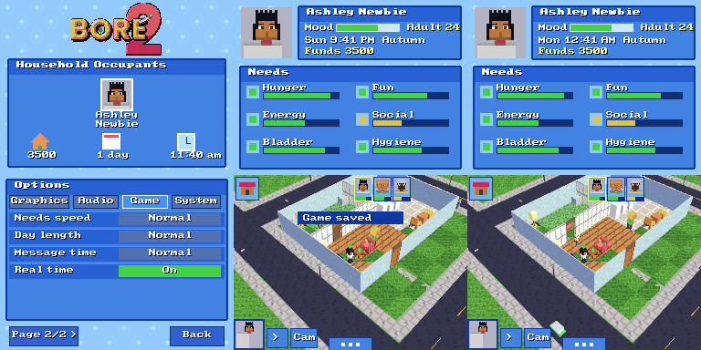

# BORE 2 DS / DSi: roadmap (updated at D43)

## Where we are
A Sims-DS style life sim on two screens, one ROM (`bore2_dsi_d43.nds`) that runs on DS, DSi and the emulators (melonDS, DraStic, NooDS, DeSmuME).
Tested in melonDS only. Not yet tested on real hardware or on Android emulators.

**Done**
- Title (new BORE 2 logo, Household Occupants, Start/Load), Create-a-Sim (12 hairs, beards, faces, 26 sliders, paint pad), Map with drag editor, LIVE, drag Buy and Build, 400 items per lot, yards, fences, life stages, families, citizens and cars, shops and parks, 2000-bore cap.
- Saving (D22-D24): 8 KB EEPROM, A/B copies with a checksum, 48 remembered lots, stats; "Save space: Safe/Max".
- Real ARM7 (touch, sound), tabbed Options (Graphics / Audio / Game / System), Options inside a lot, jagged-ground fix (D27).
- **Music (D29): the PS1 jukebox on the DS, no streaming.** All 52 songs. `tools/dsmusic/mk_dsmusic.py` reads `assets/SONGS.BIN`, decodes each instrument from the PS1 sound chip's ADPCM, re-encodes it as DS IMA-ADPCM, and flattens every song to a time-ordered note list with the voices already shared out (9 voices; the rest of the 16 channels are kept for the game's own sounds). `tools/dsbuild/addmusic.py` appends the result (`assets/dsmusic.bin`, 5.7 MB) to the .nds and patches its address into the game (`MUS_LOC`). At run time the game reads one song (about 300 KB at most) off the cartridge into RAM and plays each note on a sample channel, once a frame. No streaming, almost no CPU.
  - Audio tab: Music source (Songs / Synth), Song (Auto or 1-52). Auto: the title song (THE DIPPER MAN) on the title, then a random song in the game, the next when one ends. The Options title shows what is playing.
  - Safe fallback: if the cartridge cannot be read (a loader that only gives us the code), the old synth tunes play.
  - Known limits: no reverb or per-song effects (the DS has none), polyphony 9 (busy songs drop the oldest note), IMA-ADPCM is about 22 dB signal-to-noise (a little hiss), a song change pauses the game for a moment while it loads. Band, DJ and Superstar modes are not ported, so no per-player skill changes to the music yet.

**Done at D30-D31**
- D30: Buy cards, Create-a-Sim restyle with name picker, property system (buy and sell lots on the Map, owned lots only for Buy/Build, saved).
- D31: **Careers** (6 jobs, 5 levels each, shifts Mon-Fri 6am-3pm, good or bad shifts, promotion, demotion, fired; menu > Job). **Wants and fears** (3 wants and 1 fear per sim, aspiration stars, bonus cash; menu > Life shows them on the top screen). **The dog** (buy the Puppy in Pets, pet / play / feed). **Ghosts** (a sim who dies comes back at night, spooks the household). **Roofs and storeys** in Build (Roof: none / flat / gable, Storeys 1-3; shown with Options > Roofs: Cutaway / Always / Hide; the upper floors are a shell for now, sims do not walk upstairs). **Catalogue** grew from 28 to 52 items (6 new tabs: Cook, Bath, Fun, Study, Patio, Pets, with 24 models). **Jukebox screen** (menu > Songs: all songs, Next, Mix, plus a "Now playing" toast).

**Done at D33**
- **Toolchain check.** The DS build chain in /tmp (`/tmp/dsb`, `/tmp/libnds182`, `/tmp/crtls_old`, melonDS core in `/tmp/mb`) was still there; `dsrun` was rebuilt from `tools/dsemu/run.cpp`. The rebuild-from-source steps are now in `tools/dsbuild/README.md`.
- `src/bigmap.c` (shared with the PS1) now asks for `ram8`, `xalloc`, `dbg_miss` and `world_gh_reset`. The DS gives harmless stand-ins at the top of `main.c` (no 8 MB heap, no world.c height cache).
- **Options closer to the PS1:** Game tab: Needs speed (Never fall / Slow / Normal / Fast), Day length (Short / Normal / Long / Epic), Message time (Short / Normal / Long). Audio tab: Title music (Off / On), Game music (Off / On; Off = quiet in the game unless you picked a song or a synth track yourself), Shuffle songs (In order / At random, for Auto in the game). System tab: Reset game (puts the Game tab back). "Reset all" is always the last row.
  - Same scales as the PS1: needs fall at 0 / 50 / 100 / 150 %, a game minute takes 66 / 100 / 150 / 250 % as long, messages stay 0.5x / 1x / 1.7x. Work shifts drain needs by the Needs speed too.
  - Not added: Thought bubbles (the DS shows none yet). PS1-only pages (People, Light, Camera, Screen, Cheats) have no DS counterpart yet.
  - Saving: the new options are in their own block ('OX') after the life block; a save from before D33 loads with the old options kept and the new ones at their defaults.
- **Property fix: one home, any number of properties.** The game now keeps which lot you live in (gold outline, HOME) apart from the lots you own (light blue outline, PROPERTY).
  - You cannot buy a house a family lives in ("Family home", no Buy button). Empty houses and empty land are for sale.
  - Buy and Build only on lots you own (as before). Visit works on any lot, your properties too.
  - "Move in" on a property makes it your home and takes you there; the old home stays yours as a property.
  - You cannot sell your home ("move out first") or the lot you are standing on.
  - The home is saved ('HM' block); a save from before D33 takes the lot you were on as home.
  - Bug fixed: entering a lot no longer resets your funds to 3500 (you could buy a lot and get the money back by visiting).
- Tested in melonDS: every Options tab and page, each new option's effect, save and reload (old and new saves), and the whole property flow with a save and reload.

**Done at D34 (`bore2_dsi_d34.nds`)**
- **Bug fix: a touch held over a screen change.** Tapping OK on the title, the Map button in Live or the Map chip in Buy/Build and keeping the stylus down picked the block under it as soon as the Map came up (the title's OK even chose an empty field as your first, free lot). Now every new screen ignores the stylus that opened it until it is lifted; a fresh tap counts at once.
- Tested in melonDS: title OK held for 4 frames, Live Map button held for 50 frames (the selection stays on the home), then a tap and a drag on the Map still pick blocks.

**Done at D35 (`bore2_dsi_d35.nds`): the PS1's whole buy catalogue**
- **189 items in the PS1's ten tabs** (Seats, Beds / Tables, Storage / Kitchen, Bath / Fun and Tech / Decor, Plants / Garden, Outdoor / Skate / Boreagotchi / Party / Special), cheapest first as on the PS1. That is every item the PS1 sells (137 in the nine named tabs, the rest in Special) except the door and the stairs (Build makes doors; the stairs come with walkable floors), plus the DS's own 10 (rocker, kitchen sink, bar, towels, console, books, swimming pool, puppy, dog bed, dog bowl).
- **The models are the PS1's own.** `tools/dsbuild/mk_dsitems.py` reads the PS1 items (`src/items.c`, `items_data.inc` and the GBA art headers it includes, and every pack: furniture, gotchi, party, band, space, farm, home, beds), keeps each box with two flat colours (the average of its side art and of its top art), applies the PS1's life-size table, and writes `ports/dsi/source/ds_items.h`. The DS draws them with its lit boxes (PS1 units: 10 DS units across, 7 up; a two-tile thing stretches over both cells). The 52 items the DS already had keep their hand-made DS models but take the PS1's names, prices, tabs and action words.
- **Two-tile things** (single bed, family bed, four-poster, toddler bed): they cover 1x2 or 2x2 cells, turn with Turn, block walking on every cell; Buy checks the whole footprint ("Not enough room", "Something is there"), Move drags the whole thing.
- **What a Bore does with it, in the PS1's words:** the action is the PS1's (sim.c `action_for` / `act_hint`: "Throw Darts", "Shoot Hoops", "Sing Karaoke", "Feed the Fish"...), mapped onto the DS's six needs (eat, toilet, sleep, shower, sit, fun, read, coffee, run, phone). Things with no action are looked at (or admired, in Decor).
- **The shop:** ten tab chips with pictograms, six cards a page with the tab name, page n/m and arrows; each card shows a little picture of the item's own 3D model (its boxes seen from the front and a little above), the price, and who may use it (or its size, 1x2). The place panel shows a bigger picture and the turned size. The item popup in Live is wider for the PS1's longer words.
- **Saves:** objects keep their ids (c * 4 + i), so every older save loads unchanged; a save from a newer ROM with unknown items drops them instead of crashing.
- **Fixes found on the way:**
  - Short taps: the vblank tap latch called `touchReadXY(&t)`, which in libnds 1.8.2 takes no argument and returns the struct, so `t` stayed garbage and any tap shorter than one pass of the main loop landed at a random place (in Buy most 3-frame taps were lost). Now `touchRead`.
  - Speed: every lit quad worked out its normal with soft floats and a square root; box faces (nearly all of them) now get theirs without floats. Buy went from about 15 to about 58 frames a second in melonDS, Live from about 30 to 45.
  - The Live icons (house, portraits, Cam) no longer stay over Buy's 3D view after the menu's Buy.
  - Tapping an item in Live tests the item's whole box as the camera sees it, nearest first: tall and thin things (a dartboard on its post, a lamp, a fridge's top) are caught where they are drawn, not by the floor behind them.
- Tested in melonDS: all ten tabs and their pages; every tab's items laid out on a bare plot (a test-only key in a `-DDSTEST` build) and looked at; buying and placing a 1x1 and a 1x2 bed, turning it 2x1; a D34 save loaded in D35; a save with new items (single bed, dartboard) saved and reloaded; tapping the dartboard in Live gives "Throw Darts" and the Bore walks over and plays.

**Done at D36 (`bore2_dsi_d36.nds`): walkable storeys and stairs**
- **Up to four storeys** (the ground and three more; the PS1 has six). Each upper storey has its own floor (cells without one are open air), walls, doors, fences and things, as the ground does. Build and Buy work on one storey at a time: the **Floor N** chip at the top right of their screen steps through them, the plan shows that storey (open air dark, a stairwell marked), and the 3D view rises to it with the storeys above cut away.
- **The PS1's rules:** an upper floor needs something under it or a floor beside it on its own storey; a stairwell stays open; Erase upstairs takes the floor itself away (not under a thing); things upstairs stand on floor only ("Build a floor there first").
- **Stairs** (Buy > Special, $400, the PS1's STAIRS): a flight of eight steps from its open front up a whole storey. Placing it opens the cell above it as the stairwell ("No storey above the top one" on the top storey); selling it closes the stairwell again; it cannot be moved (as on the PS1). In Live, tap the flight: **Go Up** walks the Bore to its foot and up to the cell behind it on the storey above ("Build a floor where the stairs come out" if there is none); tap the stairwell from above: **Go Down** walks to the landing and down to the cell in front of the flight ("Something is in the way down there").
- **Sims on storeys:** each Bore walks on its own storey (pathfinding per storey, only on floor), the camera rises to your Bore's storey and the storeys over it are cut away (Roofs: Always shows the whole house; Cutaway shows it when nobody is in it; the roof sits on the top storey). Taps pick on your storey. A baby is born on its parent's storey.
- **Generated homes:** the map's TWO-STOREY lots now have the PS1's loft up the stairs (a floor over the back rooms with a bed, a lamp, a rug and a computer, and a gable roof).
- **Saves:** a lot's upper storeys follow its things (a spare bit of its count says so), the sims' storeys have their own block; a lot saved before D36 with Storeys 2-3 gets its old shell turned into real floors with walls round them on entering. Item ids are now fixed in `tools/dsbuild/ds_item_ids.txt` (a saved thing is its id; new PS1 items only ever add lines), and D35's ids are unchanged.
- **Fixes:** the gable roof's two end triangles were drawn upside down (under the ground) everywhere: on the lots, the neighbours' houses and the Map preview. The street round the plot in Buy/Build is drawn after the house (and its lane dashes are flat), so when the DS's polygon list is full it is the scenery that goes, not the fridge.
- **Readout:** Options > Graphics > Poly meter now shows the frame rate too (Live: on the top screen; Buy, Build, Map: in the top screen's corner).
- Tested in melonDS: a TWO-STOREY lot's loft (plan and 3D at each storey); Go Up and Go Down in Live; a save made upstairs reloads upstairs; a D34 save with "Storeys: 2" loads as a real second floor; flat and gable roofs on the loft; stairs bought and placed.

**Done at D37 (`bore2_dsi_d37.nds`): travel and Castaway Island**
- **Travel (menu > Travel, the PS1's "Where to?"):** Home, The Man Base, Castaway Island, Strange Town and San Boreas (the Map, a taxi to any lot). As on the PS1, the island opens after the household's first paycheck and the town after two promotions; a locked row is grey with what opens it. In the zones a **boat** (on the island) and a **bus stop** (in the town and at the base) open the same panel ("Sail", "Take the Bus").
- **The zones are lots of their own**, off the San Boreas map (3x3 lots each, the sea or the desert round them; the Bore walks from one to the next as in the city):
  - **The Man Base:** a house with a loft up the stairs (bedroom), the factory and the rail park.
  - **Strange Town:** main street (bus stop, benches, the arcade and skate flags), the diner, the trailer and the lab, on desert sand.
  - **Castaway Island:** the camp (campfire, palms, bushes, rocks), the jungle, the hills, the east beach with the wreck, and the islet out at sea. Sand everywhere, no roads.
- **Castaway Island, the PS1's rules at DS size:**
  - **Gathering:** tap a palm: "A Coconut" (food), "Chop Wood" (+1 wood), "Gather Leaves" (+2); rocks give stone, berry bushes food and leaves, the fishing spot 2 food (3 with a spear, and quicker). The stock is on the top screen ("W S L Food" and the secrets found, n/8).
  - **The campfire:** "Cook and Eat" (uses food) and "Craft": tent (3 wood, 4 leaves), log bench, outhouse, spear, a wooden shelter (12 wood, 2 stone, 8 leaves: a 5x5 room with walls, a door, a bed and a bench), the raft (10 wood, 6 leaves, put on the shore). Things are built next to the fire; trees and bushes in the way are cleared and their wood is yours.
  - **The raft:** "Sail Across" to the islet and back (everyone comes).
  - **Eight secrets** as on the PS1: the message in a bottle, the buried treasure ($2500, "dig by the big rock"), the idol, the wreck ($500 and a map), the seashells, the hermit's journal, reaching the islet, the golden idol ($10000).
  - Needs fall as everywhere: the tent is a bed (Sleep), the outhouse a toilet, the log bench a seat, and "Cook and Eat" at the fire uses one food.
- **Smoother 2D screens:** the top status screen, the Live icons, the Buy/Build catalogue and the Map are drawn off screen and copied over in one go, so a half-drawn screen is never shown (melonDS screenshots used to catch the top screen mid-redraw).
- **Saves:** a 'ZN' block after the storeys: the zone you are in and the island's stock, spear, shells and secrets. A save made in a zone loads straight back there (in Live; the Map has no zones). Older saves load with no trip and an untouched island.
- **Also:** a Bore who dies now leaves the PS1's gravestone ("Remember") instead of a statue.
- Tested in melonDS: the travel panel (locked and open rows); The Man Base; a work shift unlocking the island; the camp: the campfire popup, crafting a tent, a shelter and a raft (with a test-only stock key in a `-DDSTEST` build), "Not enough to make that"; palms: Chop Wood gives wood; the raft popup and sailing to the islet (secret 1/8 to 2/8 with the golden idol, funds +$10000); a save on the islet reloads on the islet with the stock; Strange Town (test-only unlock), its bus stop back home; a D34 save still loads.
- Not tested: the hermit, the wreck, the shells and the treasure one by one (their code is the same pattern as the golden idol's), fishing with the spear.

**Done at D38 (`bore2_dsi_d38.nds`): FARM LIFE, the first mini-game**
- **The PS1's farm** (sim.c: the crop bed, hen coop, dairy cow and farm stand choices, `farm_midnight`), one farm for the household as on the PS1, on any lot with those things (Buy > Special) and on the map's FARM lots, which now have the PS1's layout: fifteen crop beds in rows, a barn with two hen coops, two cows and the farm stand at its door, a fence along the front with a gate.
  - **Crop bed:** Plant Wheat $2 / Corn $4 / Tomatoes $5 / Pumpkin $8 (up to 8 of each; fertilizer from the shed goes in for a bigger harvest), Water the Crops, Spray Pests $3, Harvest. Watered crops grow a stage each night (wheat 2 nights, corn and tomatoes 3, pumpkins 4; one less from farming level 5); three dry nights wither them; frost in winter kills them unless there is a greenhouse; pests (12%, 24% in summer, none with a scarecrow) eat half a crop. The harvest is plants x (2 + level/3) plus a little luck, x1.5 fertilized, x1.5 with the tractor.
  - **Hen coop:** Buy a Hen $40 (up to 6), Feed the Hens $2, Collect Eggs (fed hens lay overnight, twice as many from level 4). **Cow:** Buy a Cow $250 (up to 3), Feed the Cows $5, Milk the Cows (from level 6, twice as much).
  - **Farm stand:** Sell Produce (the PS1's prices, pumpkins x1.5 in autumn, + 4% a farming level), the buyer's Order (5-12 of one thing within 5 days, paid double), Enter the Fair (on a festival day: the tenth of each season, 10am-10pm; a pumpkin; $500 / $200 / $40), Fertilizer $6 (the shed holds 9), the next upgrade (Sprinkler $400: waters every night; Scarecrow $120; Greenhouse $900; Tractor $1500), Eat a Fresh Meal, Farm Ledger.
  - **The farm ledger** (farm_ui.c, FARM LIFE): Build (barn, silo, orchard, beehives, farm stand, windmill: they earn $60-$300 a day, + 8% a farming level, collect up to 30 days), Market (sell all of one thing, +25% with the farm stand), Contracts (three buyers a day, about twice the market price). Tap a tab, tap a row.
  - **Seasons:** the PS1's (ten days each: spring, summer, autumn, winter), shown on the top screen after the time. The DS has no weather, so no rain waters the crops (a sprinkler does).
  - **Farming skill** per Bore (the PS1's skill_farm, the same points for each job); its level shows in the ledger.
  - **What grows shows:** a crop bed draws its soil and its crop by where it stands (the PS1's rule: wheat, corn, tomatoes or pumpkins), small and green at first, then ripe (golden ears, cobs, red fruit, orange pumpkins), brown when dry, with pests on it; hens peck about in front of the coops.
  - Not ported: the PS1's plant-person events (watering too much can turn a Bore into a stalk), charisma and creativity bonuses (the DS has no such skills), the phone's ledger entry (the DS has it on the farm stand).
- **The item popup takes up to eight choices** (two columns when more than three; Cancel in its title row).
- **Level of detail by distance from the eye:** a far thing becomes one box, but "far" was measured from the point the camera looks at, so the things nearest the eye, at the foot of the screen, were drawn as blocks while the ones behind were detailed. Now it is the distance from the eye. A far thing's box is now the size of its model (a crop bed was a crate, a palm a green pillar of its full width).
- **Saves:** an 'FM' block after the island's: the fields, animals, stock, upgrades, order, ledger and each Bore's farming skill (60 bytes). Older saves load with no farm.
- Tested in melonDS (test-only keys in a `-DDSTEST` build turn the lot into a farm, jump to the next morning, and open the next farm thing's popup): planting all four crops, watering, growth over four nights (pictures at each stage), harvest ("2 Wheat picked"), buying a hen and a cow, feeding, collecting 1 egg and milking 1, selling the produce (+$23, the PS1's sum), the order shown greyed when short, the ledger (barn built for $1500, next day "1 days of the farm: +$60", market and contracts tabs), the farm reloaded from its save with the crops ripe, a D34 save in the release ROM.

**Frame rate in melonDS** (main-loop passes a second, the DS's 60 Hz; in brackets the poly meter's count, two per quad: the DS draws at most 2048 polygons and 6144 vertices, about 1536 quads). Default lot (the generated house, 3 sims, citizens and cars in Live):

| Scene | D34 | D35 | D36 | D37 |
|---|---|---|---|---|
| Map | 60 | 60 | 60 (311) | 60 |
| Live, the house | about 32 | 43-45 | 43-45 (1363) | 43-45 |
| Live, upstairs in a two-storey | - | - | 41-46 | 41-46 |
| Buy | about 15 | 55-56 | 55-56 (1397) | 55-56 |
| Build | - | 56-58 | 56-58 (1457) | 56-58 |
| Live, island camp | - | - | - | 47-48 (1580-1940) |
| Live, Strange Town main street | - | - | - | 47-53 (1820-1940) |
| Live, The Man Base | - | - | - | 44-53 (2730-2750) |

At D38 (level of detail by the eye; more things near the eye keep their detail): Live, the house 49-53 (2812-2982); Live, a farm lot with fifteen crop beds 46-51 (2710-2744).

**Done at D39-D41 (`bore2_dsi_d41.nds`): steady 30, a longer view, a sky**
- **D39, the 3D as recorded lists.** The lot's 3D is written into RAM as the GPU's own packed commands (a vertex that shares two coordinates with the one before goes as one word; a box face gets its normal without maths) and sent by DMA. Four lists: what moves (Bores, doors, hens, the dog, ghosts, citizens, cars, the cursor) every frame; the lot's build (lawn, floors, walls, roof), its things, and the world round it (streets, lamps, the lots next door, the far ring, the horizon) each recorded again only when its signature changes, at most one a frame. A Bore's model is recorded once for its looks and stride and placed and turned by one matrix (lighting turns with it). The vblank interrupt sends a finished frame every second vblank, so the 3D is a steady 30 while the game and the touch screen run at up to 60 (the game steps by the vblanks gone by, so it keeps its speed). Faces turned away are skipped by the GPU. The Live top screen redraws only what changed (the clock was redrawing the whole screen every game minute). Options > System > Frame rate: Steady 30 / Up to 60.
- **D40, the look.** A sky drawn by the 2D engine behind the 3D (one colour a scanline, set by hblank DMA on channel 1, graded to the horizon for the camera's tilt); the GPU's fog on alpha only fades the far land into it. The land goes on past the 3x3: a ring of plain lots with their streets (two slots out on a DS, three on a DSi), each drawn round its own corner by a matrix move, then a horizon quad scaled four times out to the far plane (18 units on a DS, 22 on a DSi; 12 before). Options > Graphics > 3D look: Classic (as D38) / Rich (sky, haze, soft highlights from a shininess table) / Toon (Rich with outlines: each thing has its own polygon id for edge marking, hard highlight bands). Options > System > Detail: Auto / DS / DSi (Auto measures the CPU with a register loop in the ITCM: 134 MHz means the DSi's view and twice the crowd, 24 citizens and 12 cars). Turbo CPU: Auto / On / Off.
- **D40-D41, the PS1's placement fixes on the DS.** Street lamps stand on the pavement at the kerb with the lamp out over the street (half way on the lot's side, by the corner across), a bin in the pavement's corner square; citizens walk the pavements and cross at the corners (the DS's own stale offset: cells 13-17 were all "street", so they walked in the lanes and spawned there). Things stand on what is under them: a floor, or the lawn outdoors (they all stood at floor height); Bores stand on the floor indoors (they were sunk 40 units into it) and citizens on the pavement.
- **Saves:** format unchanged; the new options default for older saves. A D38 save loads, saves and reloads in D41.
- **Toolchain:** `tools/dsbuild/restore.sh` brings the prebuilt chain back from the `ds-toolchain` branch. Bench: `tools/dsemu/tb.sh outdir [scene...]` builds a `-DDSTEST` ROM and prints per scene the 3D frames a second, the loop passes a second (UI), the quads sent and the GPU's polygon and vertex use, with a screenshot each (`tools/dsemu/bench.py`; test scenes are poked into `test_scene` with the runner's `POKE`). `tools/dsemu/peek.py` prints variables; `DBGPC=1` the CPUs' PCs.

**Frame rate in melonDS, D38 against D41** (3D frames a second; D41 also the game/UI loop a second; screenshots in `docs/ds_shots/`, d38_* and d41_*):

| Scene | D38 | D41 3D | D41 UI | GPU polygons D41 |
|---|---|---|---|---|
| Map | 60 | 30 (Steady 30) | 60 | 150-250 |
| Buy | 55-58 | 30 | 55-60 | 910-950 |
| Build | 55-58 | 30 | 55-60 | 910-950 |
| Live, the house | 47-52 | 30 | 53-58 | 750-800 |
| Live, Castaway Island | 47-53 | 30 | 55-60 | 340-380 |
| Live, a farm lot | 47-50 | 30 | 52-56 | 590-680 |
| Live, a busy street (low camera, citizens, cars) | 47-51 | 30 | 52-60 | 950-1020 |
| Live, Strange Town | 48-51 | 30 | 52-56 | 350-390 |
| Live, low camera to the horizon (new) | - | 30 | 55-60 | 1180-1230 |
| Live, the camera turning all the time (new) | - | 29-30 | 53-58 | up to 880 |
| Same with Detail: DSi (on a DS's CPU in melonDS) | - | 30 | 52-60 | street 1030-1120, horizon 1300-1380 |

D38's rate went up and down between 47 and 58 (judder); D41 holds 30 on every scene, the loop that reads the touch screen runs at 52-60. The GPU's limits are 2048 polygons and 6144 vertices; the busiest view (DSi detail, to the horizon) uses about 5500 vertices, and the far ring is sent last so it is what would be dropped.
Not measured: real DS / DSi hardware (DSi mode cannot run in this melonDS build without the DSi's BIOS and NAND).

**Done at D42-D43 (`bore2_dsi_d43.nds`): roofs and textures**
- **D42, roofs as the PS1's** (world.c roof_region, b_see): the lot's enclosed buildings are found (cells the outside cannot reach without crossing a wall or a shut door; walls inside a building do not part it), and each gets its own roof over its own top storey: HIP, GABLE (plaster gable ends) or FLAT (slab, parapet, a box on top), eaves a third of a tile over the walls, the slopes levelling off three cells in. Style, colour (CLAY RED, SLATE, CEDAR, MOSS GREEN, NAVY, SANDSTONE) and pitch (MEDIUM / STEEP) are each building's own dice, as in San Boreas; towers and big blocks flat; the island's huts cedar gables. Build > Roof sets one style for the lot: Auto / Flat / Gable / Hip (the save keeps the same two bits; old "None" is now Auto). Options > Roofs: Cutaway hides the roof of a building one of your Bores is in and roofs over storeys below the one you look at; Always; Hide. The neighbours, the far ring and the Map's picture use the same roofs. Park benches lie along the walk (they were turned at random).
- **D43, textures**: see ports/dsi/README.md. 16 textures of 128 bytes in bank A, texture coordinates from each face's plane (one PS1 tile a cell), set once per run of faces in the still lists, so the frame rate is unchanged.
- Frame rates in melonDS at D43: Map 30 (UI 60), Buy 30, Live house 30, island 30, farm 30, busy street 30, Strange Town 30, horizon 30 (UI 52-60 everywhere). Screenshots: docs/ds_shots/d42_roofs_*.png (roofs; Options > Roofs: Always) and d43_tex_*.png; before: d41_*.png.
- Not done: textures on the Map's small picture and on the things you buy (they keep the PS1 models' flat colours), seasons on the ground textures (the PS1 tints grass by season).

**Done at D44 (`bore2_dsi_d44.nds`): Real time**
- Options > Game > **Real time** (off as it comes; saved in the options block, old saves load with it off): the clock is the DS's own clock chip, so the time of day and the weekday are yours, the season comes from the month (March spring, June summer, September autumn, December winter) and the festival is the month's first Saturday. The sky follows the clock (as Sky: Auto). Shops, work and night follow it as before.
- Needs fall per real minute as two of a normal day's game minutes (Needs speed still scales it), so a real day is not brutal. Sleep refills as fast as before; a work shift still goes by in a blink (paid at once) and the clock stays real.
- Minutes gone by while the DS was off (or since the save) are played through when you come back, a day at most (midnight: the day's roll); needs do not fall for that time. Switching it on goes straight to the real time.
- The ARM7 (tools/dsbuild/arm7/main7.c, a7.bin) reads the clock chip into the transfer region once a second by hand (libnds 1.8.2's own read came back empty in melonDS). `tools/dsemu/run.cpp`: `RTCNOW=1` (host time) or `RTCNOW="2026-11-01 21:41"` sets melonDS's clock chip (it starts at 1 Jan 2000 otherwise).
- Checked in melonDS: the option (left), live at the real Sun 9:41 PM in autumn (middle), saved, then loaded three hours later: Mon 12:41 AM, the day rolled (right). `docs/ds_shots/d44_realtime.png`

- Not done: the title screen's household card shows the saved clock, not the real one, until you go in.

## Next (in this order)
1. **Real-hardware and Android tests** of the song reader (`cart_blk` in `main.c`), saving and touch. If a loader blocks cartridge reads, add an SD (libfat) path for DSi.
2. ~~Walkable upper floors~~ done at D36.
3. ~~Catalogue to the PS1 size~~ done at D35.
4. **Graphics options still open:** screen swap, left-handed UI, text size, high contrast, colour filters. (Toon look and the long view: done at D40.)
5. **Speed:** done at D32 and D39-D41 (lists, steady 30). Still open: the ROM is a plain DS ROM (unit code 0), so a DSi runs it in DS mode; the 134 MHz clock is used when the loader (TWiLight Menu's "TWL clock") or DSi mode gives it, and the game measures it. A DSi-enhanced header (arm9i/arm7i, so `isDSiMode()` and the 16 MB are there) needs a DSi BIOS/NAND to test in melonDS. Textures for the ground and walls (VRAM A and B are free). Spread a still list's recording over two frames if a lot ever gets bigger than today's busiest.
6. **Music extras:** songs by place (shop, park, night).

## Bring over from the PS1 game
| PS1 feature | Source | DS state |
|---|---|---|
| Buy catalogue (10 tabs, ~180 items) | items.c, tools/make_items2.py | **done (D35)**: 189 items in the PS1 tabs, PS1 models, names, prices, actions; doors and stairs are Build things |
| Build tools (rooms, doors, windows, floors, roof, storeys) | world.c | walls, fences, floors, roof done; **walkable storeys and stairs done (D36)**, 4 storeys (PS1 6); no room tool or windows yet |
| San Boreas map, places, hours | bigmap.c, places.c | shared map; lot types simplified |
| Jobs, careers | places.c, story.c | **done (D31)**, simplified (6 jobs, no real workplaces) |
| Wants and fears | wants.c | **done (D31)**, 16 wants and 5 fears |
| Families, babies, ageing | pop.c | done (D18) |
| Home buying and travel | home.c, main.c (ST_TRAVEL, travel_go) | buying done (D30); **travel done (D37)**: Home, The Man Base, Strange Town, Castaway Island, San Boreas; the PS1's unlocks |
| Castaway Island | island.c, nature.c | **done (D37)** at DS size: gathering, campfire, crafting (tent, bench, outhouse, spear, shelter, raft), the islet, 8 secrets; no weather or day-night survival events yet |
| Music: jukebox | audio.c, SONGS.BIN | **done (D29), screen added D31** |
| Music: band, DJ | band.c, dj_ui.c | open (large) |
| Mini-games (skate, arcade, fight, heist, gotchi, farm) | various | **farm done (D38)** (farm_ui.c and the farm in sim.c); skate, arcade, fight, heist, gotchi open |
| Dog, ghosts, traffic | dog.c, ghost.c, traffic.c | all done (D31) |

## DSi-only ideas
Use the 16 MB RAM and the 2x CPU clock (Turbo CPU option exists), DSi camera for skin and hair colours, Wi-Fi visits, banner and icon polish.

## House generation
Done: one layout family (two back rooms, open front, four sizes). To add: two storeys, L shapes, garage, room-aware furnishing per lot type, windows, roof.

## Build notes
`tools/dsbuild/mkp.sh` builds the ROM and runs `addmusic.py`; `tools/dsemu/run.cpp` is the headless melonDS runner (`AUDOUT=file.wav` records the sound, `DBGMEM=addr,addr` prints variables every 30 frames).
Music data: `python3 tools/dsmusic/mk_dsmusic.py assets/SONGS.BIN assets/songs.inc assets/dsmusic.bin` (needs `gcc -O2 -shared -fPIC -o /tmp/adpcm.so tools/dsmusic/adpcm.c`).

## D30 done
Buy/CAS interface restyle and property system are finished. Still to test on real hardware: lot selling and ownership save round-trip.
