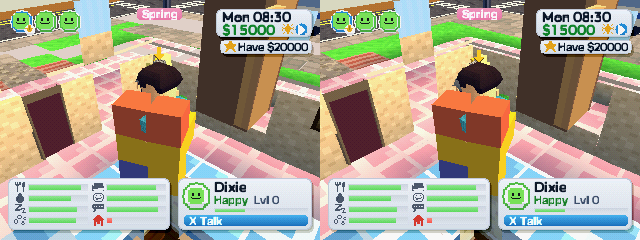
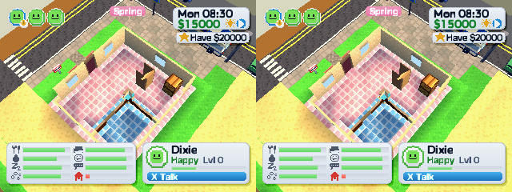
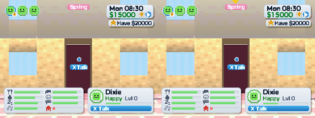

# PS1 active-lens projection consistency

Validated on 2026-11-21 with host production-code tests and native DuckStation/OpenBIOS captures. This fixes a concrete disagreement introduced when the third-person lens changed to 260 pixels. It does not change the lens choice again.

## The defect and correction

The ordinary GTE projector used the active 260-pixel lens, but `world.c::nc_proj` still used 230 when drawing nearby clipped or subdivided floors, walls and props. The same corner could therefore land in different screen positions depending on its rendering path. A reproduced view-space point `(100, -100, 500)` projected to `(212, 67)` through the real GTE-compatible path and `(206, 73)` through the old near-surface path. Both now give `(212, 67)`.

All affected live-world projections now read the existing `gfx_focal`: nearby surfaces, distant clipped polygons, building/tree billboard sizes, projected-size detail checks, far-view reach, sea bands, visibility tests and crowd bounds. The offscreen person-rendering pass still temporarily scales the GTE and restores the world lens afterward.

Cached person sprites also retain the focal length used to render them. Their size and measured bounds follow a first-person/orbit lens change while waiting for a refresh. The new `u16` consumes existing structure padding: `Spr` remains 44 bytes. This adds no sprite buffers, heap allocations or save fields. First-person and Dreamcast retain their 230-pixel lens; DS uses its independent renderer.

## Production-code regression

Run `bash test/projection_regression.sh`. It compiles the actual `world.c`, `far.c`, `crowd.c` and `gfx.c` functions against the Dreamcast port's existing C GTE, discarding unrelated functions at link time. It does not copy the renderer into a substitute formula.

- 4,860 near-surface/shared-corner comparisons across focal values 200, 230, 260 and 320 and 15 depths, including the reproduced six-pixel seam.
- Actual emitted distant-polygon packets, billboard dimensions and camera reach.
- Cached sprite lens switches, maximum supported GTE depth, and unchanged structure size.
- Real impostor begin/end lens restoration and active-focal visibility limits.

The test permits a one-pixel reciprocal-rounding difference between the existing C GTE and integer near projector. It is included in the `build` workflow. AddressSanitizer and UndefinedBehaviorSanitizer also passed for the exercised paths; this is not an exhaustive proof about every offscreen coordinate.

## Native before/after evidence

These are actual 320×240 renders. **Before is left; corrected is right.** Both sides use the same production lens: 260 for the orbit routes and 230 for first-person. This isolates the consistency correction from the earlier 230-to-260 optical change.

Baseline source: `06735cb3304e8590d2b110135444da1e91fe1896`. The fixed production-file SHA-256 values, matching state, all nine pair differences and final-frame counters are preserved in [ps1_projection_native_results.json](ps1_projection_native_results.json).

| Route | Camera mode | Changed RGB channels, three samples | Observation |
| --- | --- | --- | --- |
| Close home | `AUTO_CAMTEST=2` | 68,276 / 68,643 / 71,344 | Nearby tiled floors and cutaway walls reproject while Sim/HUD framing holds. No new missing floor, wall or door was observed in the sampled room. |
| Wide home | `AUTO_CAMTEST=3` | 0 / 0 / 0 | All three before/after frames are pixel-identical. |
| First-person | `AUTO_CAMTEST=4` | 67 / 132 / 0 | Only the animated gold marker tip in rows 0–7 differs in the first two samples. Every pixel from row 8 downward is identical; the third full frame is identical. |

### Close home



### Wide home



### First-person control



All six replays used native 2 MB RAM. The final world seed, generation, clock, city window, logical camera, camera matrix and life/floor/wall map hashes match within each pair. Each replay reached the 150-life-frame freeze and stopped at 450 logic steps. There were no packet allocation drops in the final frame of any replay. Draw-driven marker, head and sprite animation is not synchronized; pixel differences alone do not prove quality.

### Reproduce

Use PSn00bSDK 0.24/GCC 12.3.0 and the pinned DuckStation `0.1-5570-ga003832e-dirty` regression runner with OpenBIOS restored by `tools/perf/restore.sh`. In separate baseline/fixed source checkouts, configure Release with Ninja and these C flags, choosing camera mode 2, 3 or 4:

```text
-DAUTO_CITY=1 -DAUTO_LOTS=0 -DAUTO_LOTS_K=6 -DAUTO_CAMTEST=2
-DAB_LOCK4=1 -DAB_FREEZE=150 -DAB_NOSHED=1
```

Build the `iso` target. Supply a `DSSCRIPT` containing `3000 shot`, `3200 shot`, and `3400 shot`; replay 3800 frames with `DSCROP=None DSRAW=1`, separate `DSRAM` paths, no `DS8MB`, and `-dumpinterval 100000`. `GAMESTART` is an OpenBIOS-shell marker, not the start of live gameplay. Use each ELF's own symbol addresses to compare final RAM state, as the [lens harness](../test/ps1_camera_visual.sh) does.

## Related native camera check

[PR #10](https://github.com/masong0508-lab/bore2/pull/10), merged as `82f49a9`, adds the separate legacy-230 versus current-260 lens comparison. Its final head `902786b` passed [PS1 disc/world checks](https://github.com/masong0508-lab/bore2/actions/runs/44966694452) and [native frozen-camera CI](https://github.com/masong0508-lab/bore2/actions/runs/44966694552). All three CI image pairs were byte-identical to the manually inspected local captures. That suite exercises one close-home angle three times and verifies matching final world/camera state.

## Remaining work

This is a partial OW-003/OW-004/QA-002 correction. The wide-home control does not exercise every distant scenery path; the production-code tests cover those paths separately. More lots, stair directions, skate ramps, roof cutaways and moving camera transitions still need native review. Camera collision/occlusion and affine texture swimming are separate problems. Locked test pacing and isolated final-frame counters are not physical-console FPS measurements.
